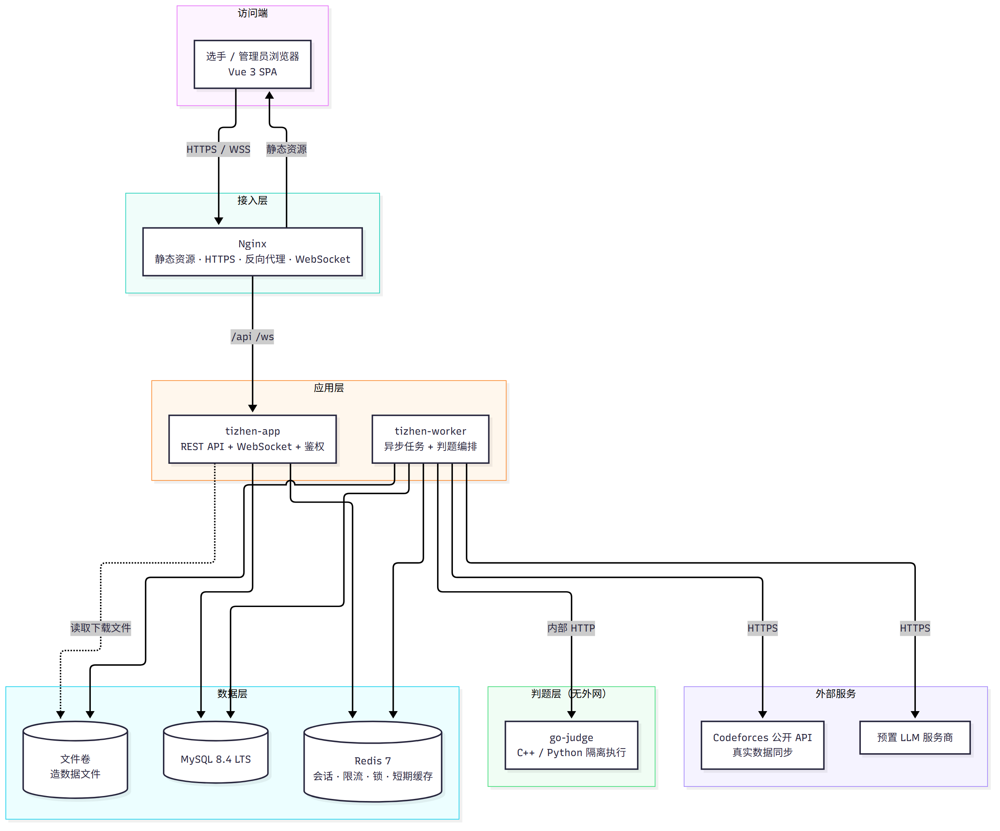

# 题阵

算法训练与对战平台：学习路线、题库与判题、榜单、1v1 对战、AI 造数据与运营后台。

项目采用 Java 21 + Spring Boot 3.5 + Vue 3 的模块化单体架构，已完成首期范围内的全部业务功能，支持选手端与管理端双端使用。

**Java 21 · Spring Boot 3.5 · Vue 3 · MySQL 8.4 · Redis 7 · go-judge · 109 个 REST 接口 · 24 张表**

## 项目规模

| 维度 | 实测 |
|---|---|
| 后端 | 339 个 Java 文件、约 2.5 万行；24 个 Controller、109 个 REST 接口方法 |
| 数据 | 24 张表，由 3 个 Flyway 迁移版本化管理 |
| 前端 | 51 个 Vue 组件、36 个路由，约 2.26 万行 Vue/TS |
| 异步执行 | 独立 `tizhen-worker` 进程，`FOR UPDATE SKIP LOCKED` 多实例安全领取 |
| 文档 | 9 份，含 PRD、功能梳理、整体架构、数据库设计、API 设计、**设计评审结果** |
| 测试 | JUnit 5 + Testcontainers；Vitest + Vue Test Utils；Playwright 端到端 |

## 架构



<!-- 图表源文件：docs/images/architecture.mmd，可用 mermaid-cli 重新渲染 -->

### 三个关键决策

- **模块化单体，不拆微服务。** 首期约束是注册 < 1 万、日活 < 1 千、同时判题 < 50，9 个模块共享同一套账号、权限与事务。拆微服务只会引入跨服务调用和分布式一致性成本；模块边界由包结构、接口与 ArchUnit 测试约束，未来可按模块拆出。
- **异步执行单独成进程。** 判题与造数据是资源密集且执行的是不可信代码，因此拆出 `tizhen-worker` 并接入 go-judge 沙箱，`tizhen-app` 永不执行用户代码。worker 可以独立扩容、独立重启。
- **首期不引入消息队列。** 单机规模下，数据库任务表 + `SKIP LOCKED` 已能满足多实例并发领取、失败重试与幂等回写，少一个需要运维的组件；量级上来后按「消息投递 + 幂等消费 + 延迟重试 + 死信对账」替换，业务接口不变。

## 技术架构

| 层 | 技术 |
|---|---|
| 后端 | Java 21、Spring Boot 3.5、MyBatis-Plus、MySQL 8.4、Redis 7、Spring Security + Spring Session、Flyway、MapStruct |
| 前端 | Vue 3、TypeScript、Vite、Vue Router、Pinia、Axios、Element Plus、CodeMirror 6 |
| 实时通信 | 浏览器原生 WebSocket + Spring WebSocket（会话身份复用 Spring Session） |
| 判题 | go-judge 沙箱服务，由 `tizhen-worker` 异步消费判题任务 |
| 文件存储 | 本地文件卷 + `FileStorage` 抽象，头像经魔数与尺寸校验后落盘 |
| 测试 | JUnit 5、Testcontainers、Vitest、Vue Test Utils、Playwright |
| 部署 | Docker Compose（本地开发依赖），生产编排待补充 |

### 后端模块

| 模块 | 职责 |
|---|---|
| `tizhen-common` | 统一响应信封、错误码、全局异常处理、请求 ID、通用校验 |
| `tizhen-core` | 实体、Mapper、领域服务、Flyway 迁移、文件存储、榜单与判题领域逻辑 |
| `tizhen-app` | REST 接口、Spring Security、Spring Session、WebSocket 对战、媒体访问 |
| `tizhen-worker` | 判题消费、简答 AI 判分、AI 造数据、CF 同步、过期数据清理 |
| `tizhen-test-support` | Testcontainers 集成测试基类与测试工具 |

### 关键设计

- **异步判题**：提交落库后由 worker 通过 `FOR UPDATE SKIP LOCKED` 领取任务，支持多实例并发消费与幂等回写，避免重复判题。
- **榜单聚合**：基于 CTE 聚合站内 AC、Codeforces 与手动申报数据，使用 `RANK()` 处理同分并列，禁用用户自动排除。
- **认证与安全**：Spring Security + Redis Session，Cookie CSRF 防护，选手/管理员双端认证；上传文件校验魔数、尺寸与受控访问路径。
- **AI 能力**：简答题判分使用平台密钥；AI 造数据支持选手自带 Key，凭证加密存储，生成结果逐组校验。
- **前端工程化**：全局设计令牌统一明亮/暗淡主题，Axios 统一封装响应与 CSRF，关键流程使用 Playwright 端到端验证。

## 功能范围

| 模块 | 能力 |
|---|---|
| 账号与个人中心 | 注册登录、资料编辑、头像上传、邮箱/手机号绑定、CF 绑定、其他平台成绩申报、LLM API Key 凭证 |
| 首页与学习路线 | 路线/阶段浏览、图文与视频课程、外链题、站内练习题、手动完成阶段 |
| 题库与判题 | 客观题自动判分、简答题 AI 判分、OJ 编程题提交与 go-judge 沙箱判题、提交记录 |
| 榜单 | 全站周榜与历史总榜，聚合站内 AC、Codeforces 与手动申报数据，支持分页与我的排名 |
| 学习记录与错题本 | 阶段进度、提交/AC 历史、错题聚合与手动移除 |
| 1v1 对战 | 房间邀请码、同题竞速、先 AC 获胜、WebSocket 实时状态、对战记录 |
| AI 造数据 | 随机生成、LLM 构造、LLM 直接生成数据三种模式，std 校验与测试数据下载 |
| XCPC 说明页 | 站内赛事说明与外部评分入口 |
| 运营后台 | 路线/阶段/题库/用户/榜单/角色/管理员账号/操作日志/造数据任务管理 |

- 后端 5 个 Maven 模块，109 个 REST 接口，Flyway 管理 24 张表。
- 前端 34 个页面，选手端与管理端按路由树拆分，支持明亮/暗淡双主题与移动端适配。

<!--
截图就位后取消注释，并把 docs/images/README.md 里的 6 张图放进去。
## 界面预览

| 学习路线 | 题库与判题 |
|---|---|
|  |  |

| 1v1 对战 | 运营后台 |
|---|---|
|  |  |
-->

## 目录

```text
backend/       # Maven 多模块后端（common / core / app / worker / test-support）
frontend/      # Vue 3 单页应用（选手端 + 运营后台）
judge-runner/  # go-judge 沙箱配置与语言环境说明
deploy/        # 本地开发基础设施与部署资产
docs/          # 需求、设计文档与开发规范
prototype/     # 页面原型参考
scripts/       # 开发环境脚本
```

## 本地启动

### 1. 准备环境

需要 JDK 21、Maven 3.9+、Node.js 20+、Docker Desktop。

首次使用：

```bash
cp deploy/.env.example deploy/.env
# 编辑 deploy/.env，填写 MySQL、Redis 密码与管理员初始化账号
```

若本机 3306/6379 已被占用，可在 `deploy/.env` 中修改 `MYSQL_PORT` / `REDIS_PORT`；Docker 编排与后端都会读取同一组变量。

### 2. 启动 MySQL 与 Redis

```bash
bash scripts/dev-up.sh
```

停止但保留数据：

```bash
bash scripts/dev-down.sh
```

表结构由后端启动时的 Flyway 自动创建，无需手工执行 SQL。

### 3. 启动后端

```bash
cd backend
mvn clean install -DskipTests
```

分别启动应用与 worker（建议两个终端）：

```bash
# 终端 A：Web 应用
set -a
source ../deploy/.env
set +a
export MYSQL_PORT=${MYSQL_PORT:-3306}
mvn -pl tizhen-app spring-boot:run

# 终端 B：异步 worker（判题、简答判分、造数据、CF 同步、清理）
set -a
source ../deploy/.env
set +a
export MYSQL_PORT=${MYSQL_PORT:-3306}
mvn -pl tizhen-worker spring-boot:run
```

- 健康检查：http://127.0.0.1:8080/actuator/health
- 接口文档：http://127.0.0.1:8080/swagger-ui.html （OpenAPI JSON：`/v3/api-docs`）

> Windows 请使用 Git Bash 执行 `source`。PowerShell 需逐项设置 `MYSQL_PASSWORD`、`REDIS_PASSWORD` 等环境变量。
>
> 只浏览页面和榜单时 worker 非必需；OJ 判题、简答判分、AI 造数据需要 worker 运行。
> 判题还需要本地 go-judge 服务（默认 `http://127.0.0.1:5050`，可通过 `GO_JUDGE_URL` 覆盖）。未启动时提交会停留在待判题状态。
> LLM 构造/直接生成数据与简答判分需要配置对应服务商凭证；随机造数据不依赖 LLM。

### 4. 启动前端

```bash
cd frontend
npm install
npm run dev
```

访问 http://127.0.0.1:5173 。Vite 已将 `/api` 与 `/ws` 代理到 `127.0.0.1:8080`。

### 5. 演示路径

1. `/register` 注册选手账号，登录后进入 `/profile` 完善资料、上传头像、绑定 CF。
2. `/learning` 浏览学习路线与阶段，完成图文/视频/题目任务。
3. `/problems` 选择题型作答；OJ 题提交后由 worker 判题。
4. `/leaderboard` 查看周榜/总榜；`/battle` 创建或加入对战房间（需要两个账号）。
5. `/datagen` 使用随机或 LLM 模式生成测试数据并下载。
6. `/admin/login` 使用 `deploy/.env` 中初始化的管理员账号进入运营后台。

## 构建与验证

```bash
# 后端编译与测试
cd backend && mvn clean verify

# 前端类型检查、单元测试与构建
cd frontend
npm run type-check
npm run test:unit
npm run build

# 端到端测试（需先启动前后端）
npx playwright install chromium
npm run test:e2e
```

## 设计文档

设计先行是项目的核心工作方式：先在 `docs/` 里完成需求、架构、库表与 API 的书面设计，经过一轮设计评审再进入编码，实现完成后回写文档。

| 文档 | 内容 |
|---|---|
| [产品需求](docs/PRD-v0.9.md) | 角色、范围、验收口径 |
| [功能模块梳理](docs/design/01.功能模块梳理.md) | 9 个业务模块的职责与边界 |
| [整体架构设计](docs/design/02.整体架构设计.md) | 技术选型、分层、请求链路、关键决策 |
| [数据库设计](docs/design/03.数据库设计.md) | 24 张表的概念/逻辑/物理模型与索引 |
| [API 接口设计](docs/design/04.API接口设计.md) | 109 个接口的路径、字段与错误码 |
| [设计方案评审结果](docs/design/05.设计方案评审结果.md) | 评审提出的问题与修订结论 |
| [开发规范](docs/rules/) | API、数据库与编码约定 |

## 当前状态与边界

- 首期范围内的业务功能已完成，前后端接口、页面与 worker 均已接入。
- 自动化测试覆盖仍在补充，当前以核心流程验证为主。
- `judge-runner/` 的语言镜像与沙箱参数配置、生产部署编排（nginx TLS、app/worker/judge 镜像）待完善。
- 首期不做专题榜、审核工作流、数据看板等范围外功能。
- 单机方案：WebSocket 未做多实例广播与离线补拉，量级上来后需要网关 + 消息路由（见「三个关键决策」）。

## 约定

- 数据库结构变更只新增 Flyway 迁移，不修改 `V1__init_schema.sql`；`scripts/sql/schema.sql` 为设计快照。
- 统一响应、错误码、分页与会话约定见 `docs/design/04.API接口设计.md` 与 `docs/rules/api-rules.md`。
- 数据模型与约束见 `docs/design/03.数据库设计.md` 与 `docs/rules/database-rules.md`。
- `deploy/.env` 含本地密钥，禁止提交到版本库。
