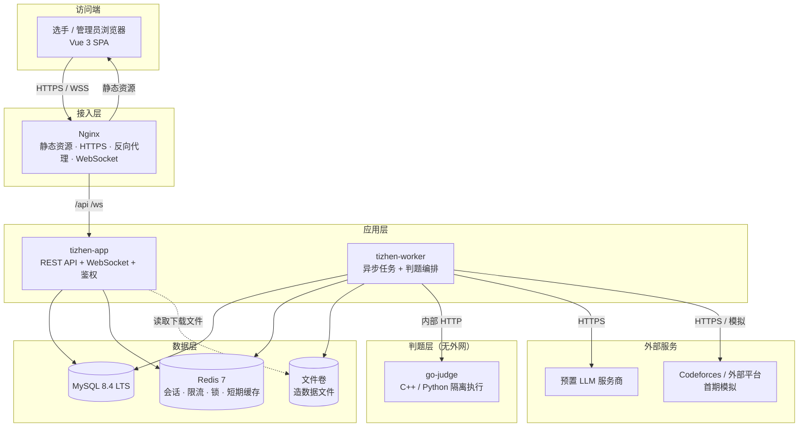
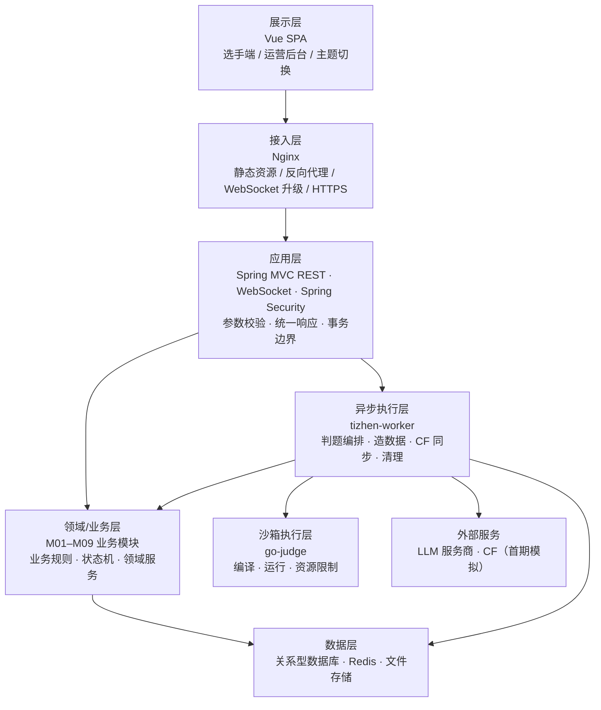
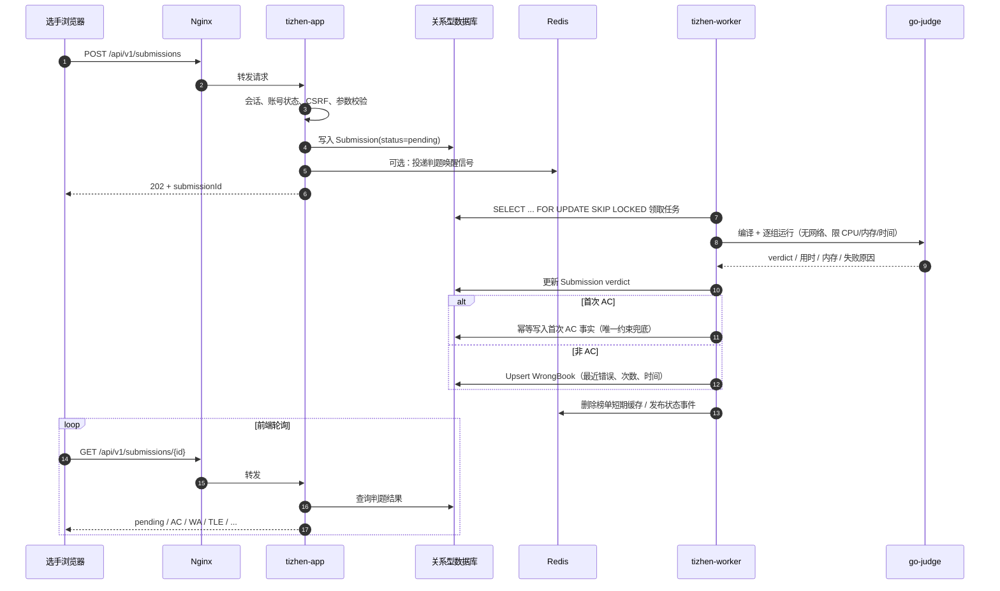
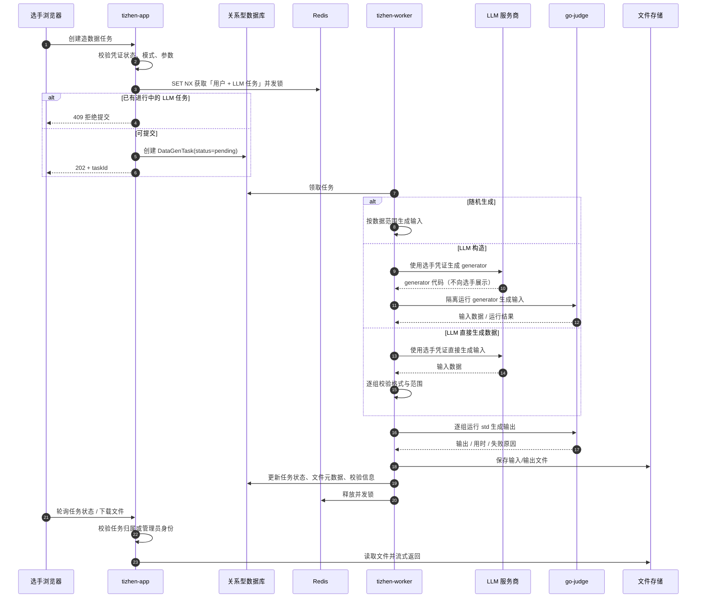
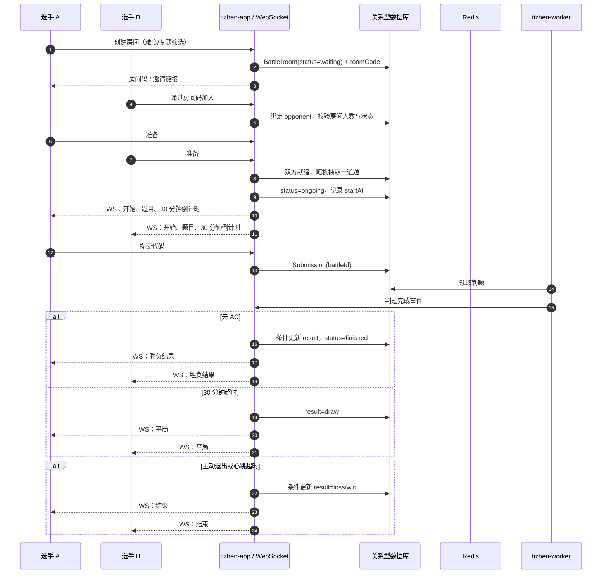
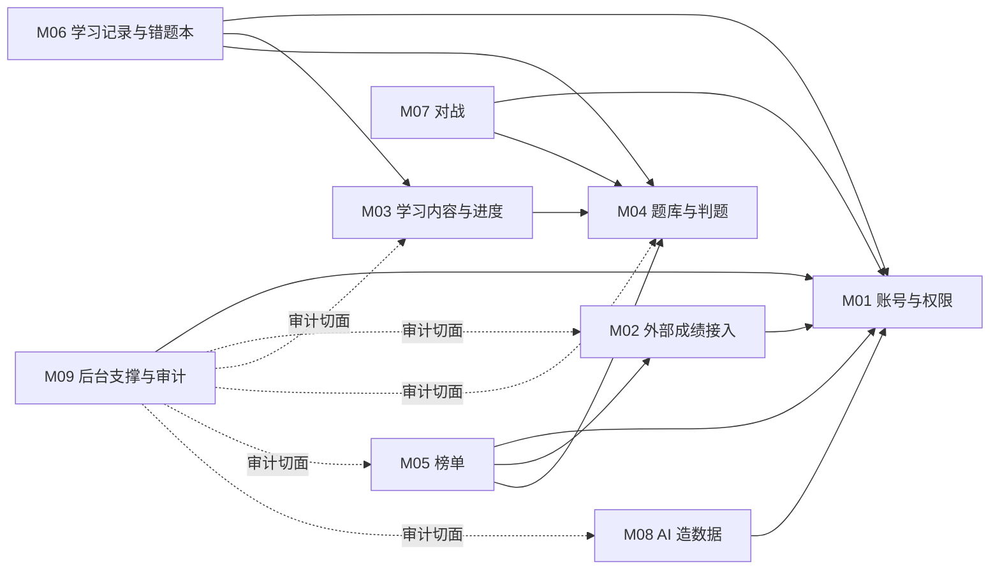

# 题阵 · 整体架构设计

> 文档版本：v0.5（设计阶段；整体设计评审修订 + v0.9 手动申报审核变更，同步缓存失效与审计口径）
> 编写日期：2026-11-09；评审修订：2026-11-10
> 依据：`docs/PRD-v0.9.md`、`docs/design/01.功能模块梳理.md`、`docs/rules/database-rules.md`、`docs/rules/api-rules.md`、`prototype/`
> 范围：技术选型、整体架构、模块架构、项目目录、关键设计决策与确认结论。
> 不在本阶段范围：数据库表结构、字段定义、API 契约、页面交互细节、业务代码。

> 名称说明：项目正式名称已确认为「题阵」；后续文档、仓库、包名与部署域名统一使用该名称。

---

## 1. 设计目标与约束

### 1.1 业务目标

首期跑通「学—练—战—榜」闭环：

- 学习路线：路线 → 阶段 → 课程 → 阶段题目。
- 站内题库：OJ 编程题、客观题、简答题、外链题。
- 判题与判分：OJ 代码隔离判题、客观题自动判分、简答题 AI 判分。
- 榜单：站内首次 AC + CF 数据 + 审核通过的其他平台手动申报，派生周榜/总榜。
- 1v1 对战：邀请制房间、同题竞速、先 AC 胜。
- AI 造数据：随机生成、LLM 构造、LLM 直接生成数据三种模式。
- 支撑能力：账号与权限、运营后台、操作日志。

### 1.2 规模与部署约束

来自 PRD 8.1：

| 项目 | 首期要求 | 架构含义 |
|---|---|---|
| 部署 | 本地/内网演示，不要求公网 | 单机 Docker Compose 即可，不引入 Kubernetes |
| 规模 | 注册 < 1 万、日活 < 1 千、同时判题 < 50 | 不需要微服务、分库分表、独立消息集群 |
| 数据持久化 | 用户、题目、提交、记录、任务持久化 | MySQL 8.4 LTS 作为唯一业务事实源 |
| 备份 | 每日全量备份数据库，保留 7 天；同步备份生成文件 | 独立备份目录 + 定时脚本 |

### 1.3 技术约束

来自 PRD 与设计规范：

1. OJ 提交代码、造数据生成器与 std 必须隔离执行，限制 CPU、内存、运行时间、文件访问和网络。
2. LLM 输出（构造器或直接生成的数据）视为不可信输入，直接生成的数据需逐组校验。
3. 选手 LLM API Key 必须服务端加密保存；接口、页面、日志、异常不得回显明文；只允许预置服务商地址，禁止自定义 Base URL。
4. 简答题 AI 判分使用平台密钥，不下发浏览器；选手凭证只用于两种 LLM 造数据模式。
5. 选手密码加盐哈希存储，登录接口限制暴力尝试；禁用账号的已登录会话立即失效。
6. 数据库对象使用 `snake_case`，主键统一自增，禁止物理外键，由应用层维护关联完整性（`database-rules.md`）。
7. API 默认 REST 风格；统一响应、分页、错误码与 HTTP 状态码（`api-rules.md`）。
8. 首期不做公网合规、第三方登录、站内视频、人工判分、随机匹配、积分段位、观战回放、内容审核流和数据看板。

### 1.4 本阶段边界

本文只确定「用什么技术、怎么分层、模块放在哪、目录怎么组织」。以下内容留到后续阶段：

- 数据库概念/逻辑/物理模型与索引。
- API 路径、请求响应字段、错误码明细。
- 页面级交互与组件拆分。
- 部署脚本、CI/CD 流水线与监控告警细节。

---

## 2. 技术选型

### 2.1 选型原则

1. **优先满足安全与隔离要求**：判题沙箱、LLM 凭证、权限校验不能为开发便利让步。
2. **匹配首期规模**：单机、低并发、单团队，优先简单可维护，不为了「看起来像大厂」引入微服务、MQ、K8s。
3. **业务模块可拆分**：代码按业务模块组织，未来可独立拆分，但首期以模块化单体运行。
4. **遵循现有规范**：REST API、无物理外键、UTC 存储、统一响应与错误码。
5. **可替换**：LLM 服务商、CF 接入、文件存储、判题执行器均通过接口隔离，便于后续替换真实实现。
6. **团队可落地**：优先选择生态成熟、文档充足、国内使用广泛的技术，降低学习和运维成本。

### 2.2 技术栈总表

| 层次 | 建议选型 | 版本建议 | 主要用途 |
|---|---|---|---|
| 前端框架 | Vue 3 + TypeScript | Vue 3.5+ / TS 5.7+ | 选手端与运营后台 SPA |
| 前端运行时 | Node.js | 22 LTS | 本地开发与构建 |
| 前端构建 | Vite | 7.x | 开发服务器与生产构建 |
| 路由/状态 | Vue Router + Pinia | 4.x / 3.x | 路由守卫、登录态、主题、对战状态 |
| UI 组件 | Element Plus + 自定义设计令牌 | 2.9+ | 表格、表单、弹窗、分页、消息等基础组件 |
| 代码编辑器 | CodeMirror 6 | 6.x | C++/Python 代码编辑 |
| 内容渲染 | markdown-it + DOMPurify | 14.x / 3.x | 题面 Markdown 渲染与 XSS 防护 |
| HTTP 客户端 | Axios | 1.x | 统一请求拦截、CSRF、错误处理 |
| 实时通信 | 原生 WebSocket + 轻量重连封装 | 浏览器原生 | 对战房间、就绪、开始、结束事件 |
| 前端测试 | Vitest + Vue Test Utils + Playwright | 当前稳定版 | 单元、组件与端到端测试 |
| 后端语言 | Java | 21 LTS | 业务服务与异步任务 |
| 后端构建 | Maven | 3.9+ | 多模块工程构建 |
| 后端框架 | Spring Boot | 3.5.x | REST、WebSocket、调度、事务、配置 |
| 安全框架 | Spring Security + Spring Session | 6.x / 3.x | 登录态、权限、CSRF、会话管理 |
| 持久层 | MyBatis-Plus | 3.5.x | 显式 SQL、分页、条件查询、榜单聚合 |
| 数据库迁移 | Flyway | 11.x | 版本化 SQL 迁移 |
| 数据库 | MySQL | 8.4 LTS | 业务数据唯一事实源；关系模型、事务、唯一约束与窗口函数 |
| 缓存/会话 | Redis | 7.4.x | 会话、限流、并发锁、短期缓存 |
| 反向代理 | Nginx | 1.27.x | 静态资源、HTTPS、反向代理、WebSocket 升级 |
| 判题沙箱 | go-judge（独立服务） | 固定版本，随部署锁定 | C++/Python 隔离编译与运行 |
| 文件存储 | 本地文件卷 + `FileStorage` 抽象 | — | 造数据输入/输出文件、临时文件 |
| 容器化 | Docker Engine + Docker Compose | 27.x / v2 | 单机部署与环境一致性 |
| 接口文档 | SpringDoc OpenAPI | 2.8.x | 开发期接口文档 |
| 对象映射 | MapStruct | 1.6.x | DTO / 领域对象转换 |
| 校验 | Jakarta Bean Validation | Spring Boot 内置 | 请求参数校验 |
| 日志/健康 | SLF4J + Logback + Actuator | Spring Boot 内置 | 结构化日志、健康检查 |
| 后端测试 | JUnit 5 + Testcontainers | 当前稳定版 | 单元、集成、数据库/Redis 集成测试 |

> 版本号只作为落地基线，实际以项目初始化时的最新稳定小版本为准；大版本升级需单独评估。

### 2.3 前端选型说明

**选择 Vue 3 + TypeScript + Vite。**

- 现有原型是纯 HTML/CSS/JS，页面结构和视觉语言已经稳定，迁移到 Vue 组件化的成本可控。
- TypeScript 能约束前后端 DTO、枚举和状态机，降低「判题状态、造数据状态、角色权限」等字段拼写错误。
- Vite 开发体验好，生产构建产物为纯静态文件，交给 Nginx 托管，部署简单。
- Vue 生态在国内文档与人才供给充足，适合单团队快速迭代。

**UI 方案：Element Plus + 自定义设计令牌。**

- 表格、分页、表单校验、弹窗、消息提示等后台高频组件不重复造轮子。
- 原型的奶油色/糖果色与暗淡忧郁风通过 CSS 变量和主题覆盖实现，Element Plus 只提供交互骨架，不把默认「通用 SaaS 风」带进产品。
- 若后续发现组件库主题覆盖成本过高，可在保持设计令牌不变的前提下替换为 Naive UI 或自研基础组件，不影响业务模块。

**不引入的东西：**

- 不引入 Nuxt/SSR：首期是登录后的工具型应用，SEO 无需求，SPA 足够。
- 不引入微前端：选手端与后台在同一个 SPA 内用路由树和布局隔离，按需加载即可。
- 不引入 ECharts：首期没有数据看板，榜单是表格而非图表。
- 不引入 Socket.IO：后端使用 Spring 原生 WebSocket，前端用原生 WebSocket 封装，避免额外协议层。

### 2.4 后端选型说明

**选择 Java 21 LTS + Spring Boot 3.5.x。**

- Spring Security、Spring Session、Spring WebSocket、Spring Scheduling、事务管理都是一体化能力，适合本项目「账号权限 + 实时对战 + 异步任务 + 事务写入」的组合。
- Java 21 虚拟线程可以让大量阻塞式数据库、HTTP、LLM 调用保持简单同步写法，避免 WebFlux 带来的响应式复杂度；首期规模下完全够用。
- MyBatis-Plus 对复杂榜单聚合 SQL 的控制力强于 JPA，便于后续做周榜/总榜的窗口函数、条件聚合和分页优化。
- 生态成熟，问题容易检索，适合作为长期维护的业务底座。

**为什么不用 Node.js/NestJS：**

- 判题编排、资源限制、后台任务、权限体系更偏向传统服务端；Node 也能做，但团队需要额外处理 CPU 密集任务、沙箱调用和事务一致性。
- 如果团队明显更熟悉 TypeScript 全栈，NestJS 是可行替代；本文按 Java 方案展开。

**为什么不用 Go 作为主后端：**

- Go 适合判题代理和高并发网关，但业务模块多、后台 CRUD 多，Java 的生态和开发效率更匹配。
- 判题执行器本身使用 Go 实现的 go-judge，属于基础设施层，不影响主后端技术栈。

### 2.5 数据库与缓存选型说明

**选择 MySQL 8.4 LTS 作为唯一业务事实源。**

- 数据关系明确：用户、路线、阶段、题目、提交、榜单来源、造数据任务都是典型关系数据。
- 事务、唯一约束、索引、窗口函数足以支撑周榜/总榜聚合。
- 选择依据：国内运维资料多、Docker 镜像成熟、MyBatis-Plus 适配成熟；8.4 LTS 生命周期长，适合单机内网部署。
- PostgreSQL 16 在 JSONB、部分索引与约束能力上更强，但本项目 JSON 字段少、榜单以关系聚合为主，MySQL 8.4 已足够；不引入双引擎。
- 表结构按规范化关系模型设计，避免依赖引擎独有语法；字段类型、字符集、索引与方言细节在数据库设计阶段确定。
- 遵循 `database-rules.md`：自增主键、`snake_case`、禁止物理外键、唯一约束兜底、UTC 存储。

**Redis 7 作为会话与短期状态层。**

Redis 不保存业务事实，只保存可重建或可过期的数据：

| 用途 | 说明 | 是否强依赖 |
|---|---|---|
| 会话存储 | Spring Session 保存选手/管理员登录态 | 是 |
| 登录限流 | 用户名/IP 维度的滑动窗口计数 | 是 |
| 并发锁 | 「同一选手最多 1 个进行中的 LLM 任务」、判题领取、定时任务互斥 | 是 |
| 对战临时状态 | 房间在线连接与心跳；就绪状态、房间状态与结果均写关系型数据库 | 否，在线状态可由连接重建，房间状态可由数据库恢复 |
| 榜单短期缓存 | 前 20 名 / 总榜首页的只读缓存，30–60 秒过期 | 否，首期可关闭 |
| 任务唤醒 | worker 轮询数据库为主，Redis 仅用于降低延迟 | 否 |

**榜单缓存策略：** 首期数据量小，榜单直接查关系型数据库；只有在压测或实际延迟不达标时，才启用 Redis 缓存。缓存失效由「首次 AC 写入、手动申报覆盖、手动申报审核/改判、CF 刷新、用户禁用/启用」触发，缓存只做读优化，不作为排名事实。

### 2.6 异步任务与判题选型说明

**异步任务：数据库任务表 + worker 轮询，不引入 RabbitMQ/Kafka。**

- 造数据任务、判题任务本来就需要持久化状态和失败原因，数据库表已经是事实源。
- worker 使用 `SELECT ... FOR UPDATE SKIP LOCKED` 领取任务，天然支持多 worker、失败重领和重启恢复。
- 首期任务量小，轮询间隔 200–500ms 足够；不需要额外维护消息集群。
- LLM 调用、沙箱执行都设置超时；失败按 PRD 要求终止，不自动重试。
- 若后续任务量显著增长，再把「任务领取」替换为 Redis Streams 或 RabbitMQ，业务状态机不变。

**判题沙箱：独立 go-judge 服务。**

- go-judge 是基于 Linux namespace/cgroup/seccomp 的判题沙箱，支持编译、运行、时间/内存/文件限制和文件 IO，适合 C++/Python 判题。
- 作为独立服务部署在 `sandbox-net`，不暴露公网；worker 通过内部 HTTP 调用。
- 用户代码运行时无网络、只读根文件系统、独立临时目录、限制进程数与输出大小。
- 备选方案：
  - `isolate` + 自研 runner：更贴近传统 OJ，但需要自己处理编译、文件复制、结果解析和并发池。
  - 每次判题启动一个 Docker 容器：隔离直观，但容器启动开销大，50 并发下资源浪费明显。
- 首期采用 go-judge，具体版本与部署参数在部署设计阶段锁定。

**为什么判题不放在主应用进程：**

- 判题是资源密集、易受不可信输入影响的操作，必须与 Web 进程隔离。
- 独立 worker + 独立沙箱便于限制资源、单独重启、后续横向扩展。
- 主应用只负责接收提交、落库、返回「判题中」，不直接执行任何用户代码。

### 2.7 文件存储与部署选型说明

**文件存储：本地文件卷 + `FileStorage` 接口。**

- 首期单机部署，造数据文件保留 7 天，本地磁盘足够；避免额外引入 MinIO。
- 文件不放在 Web 根目录，不提供静态直链；下载统一走后端鉴权接口，校验任务归属或管理员身份。
- 路径按「任务/组号」隔离，文件名随机化，避免路径穿越和猜测。
- 通过 `FileStorage` 接口隔离，后续可替换为 MinIO/S3，不影响业务代码。
- 文件保留 7 天由 worker 定时清理；只删文件，不删任务记录。

**部署：单机 Docker Compose。**

- 服务：`nginx`、`tizhen-app`、`tizhen-worker`、`go-judge`、`mysql`、`redis`。
- 网络分段：
  - `edge-net`：Nginx 与 app。
  - `data-net`：app/worker 与数据库、Redis。
  - `sandbox-net`：worker 与 go-judge；用户代码运行容器不接任何网络。
- 数据卷：MySQL 数据、Redis 数据、造数据文件、go-judge 工作目录。
- 备份：每日凌晨全量逻辑备份 MySQL，保留最近 7 份；造数据文件卷同步备份；备份文件放在宿主机独立目录。
- 开发环境：前端 `npm run dev`，后端本地启动，数据库/Redis 用 Docker Compose；判题沙箱需要 Linux 或 WSL2/Docker Desktop，Windows 原生无法运行 go-judge。

### 2.8 未采用方案汇总

| 方案 | 不采用原因 | 何时重新评估 |
|---|---|---|
| 微服务拆分 | 首期规模小、单团队，分布式事务与运维成本大于收益 | 单模块团队独立、流量或发布频率显著上升 |
| Kubernetes | 单机演示不需要编排 | 多机部署、弹性伸缩、灰度发布 |
| RabbitMQ/Kafka | 数据库任务表已满足持久化与重领需求 | 任务量、吞吐或多消费者显著增长 |
| JWT 无状态鉴权 | 禁用账号需立即失效，JWT 撤销需要额外黑名单 | 多端、跨域、开放 API |
| MongoDB | 业务关系明确，榜单需要关系聚合 | 出现大量非结构化内容且关系弱 |
| MinIO/S3 | 首期文件量小，单机磁盘足够 | 多实例、文件量增长、需要对象存储生命周期 |
| 服务端渲染/SSR | 登录后工具型应用，无 SEO 需求 | 公开内容站、搜索收录 |
| 纯自研 UI 组件库 | 表格/表单/弹窗开发成本高 | 设计系统稳定且有专门前端人力 |

---

## 3. 整体架构设计

### 3.1 架构风格

采用 **模块化单体（Modular Monolith）+ 独立异步执行进程 + 独立判题沙箱**。



**为什么是模块化单体：**

- 首期 9 个模块共享同一套账号、权限、事务和数据库，拆成微服务会产生大量跨服务调用和分布式一致性问题。
- 模块边界通过包结构、接口和 ArchUnit 测试约束，未来可按模块拆出服务。
- 判题与造数据执行是唯一需要独立进程的资源密集场景，因此单独拆 worker 和沙箱。

**两个后端运行角色：**

| 进程 | 职责 | 是否对外 |
|---|---|---|
| `tizhen-app` | REST API、WebSocket、登录鉴权、参数校验、事务写入、查询 | 是，经 Nginx |
| `tizhen-worker` | 判题消费、造数据任务、CF hourly 同步、文件清理、LLM 调用 | 否，仅内网 |

两者共享 `tizhen-core` 业务代码和同一套关系型数据库/Redis，但独立启动、独立扩容、独立重启。

### 3.2 技术分层与各层职责



| 层 | 职责 | 不负责 |
|---|---|---|
| 展示层 | 页面渲染、路由、表单交互、主题、WebSocket 客户端、前端权限提示 | 业务规则判定、权限最终裁决、敏感数据保存 |
| 接入层 | 静态资源、HTTPS、反向代理、WebSocket 升级、压缩、基础限流 | 业务逻辑 |
| 应用层 | 接收请求、认证鉴权、参数校验、调用业务服务、事务提交、统一响应 | 直接执行用户代码、直接拼接复杂业务 SQL |
| 领域/业务层 | 9 个模块的业务规则、状态机、跨模块查询端口、领域事件 | 页面渲染、HTTP 协议细节 |
| 异步执行层 | 领取任务、调用沙箱/LLM、更新状态、失败终止、定时任务 | 对外提供 API |
| 沙箱执行层 | 隔离编译与运行、资源限制、返回判定结果 | 业务判定、榜单计算 |
| 数据层 | 持久化、缓存、文件读写 | 业务规则 |
| 外部服务 | LLM 生成、CF 数据（首期模拟） | — |

### 3.3 请求链路

**普通 REST 请求：**

```text
浏览器 → Nginx → tizhen-app
  → Spring Security（会话/CSRF/角色）
  → Controller（参数校验）
  → Application Service（事务）
  → Domain Service（业务规则）
  → MyBatis Mapper → 关系型数据库
  → 统一响应 → 浏览器
```

**实时对战：**

```text
浏览器 ⇄ Nginx（WebSocket 升级）⇄ tizhen-app WebSocket Handler
  → 会话鉴权
  → BattleRoom 领域服务
  → 关系型数据库持久化房间/结果
  → Redis 记录在线连接与心跳
  → 通过 WebSocket 推送房间事件
```

**异步任务：**

```text
tizhen-app 写入任务/提交记录（pending）
  → 返回 202 / 任务 ID
tizhen-worker 轮询数据库任务表（SKIP LOCKED）
  → 调用 go-judge / LLM / 文件存储
  → 更新任务状态
  → 前端轮询任务/提交状态
```

### 3.4 关键流程时序

#### 3.4.1 OJ 提交与判题



**关键点：**

- 首次 AC 由数据库唯一约束保证幂等，避免并发提交重复计数；具体约束在数据库设计阶段落地。
- 对战提交使用同一套 Submission 与判题链路，只额外带 `battle_id`，因此榜单和错题本口径天然一致。
- 前端轮询间隔建议 500ms 起，逐步退避到 2s；不使用 WebSocket 承载普通判题结果，降低连接管理复杂度。

#### 3.4.2 AI 造数据任务



**关键点：**

- 选手 API Key 只在 worker 调用服务商时于内存中解密，不进入日志、异常信息或前端响应。
- generator 与 std 都视为不可信代码，统一在 go-judge 中隔离运行。
- LLM 直接生成的数据先校验后运行 std；任一组失败即终止，不自动重试。
- 文件先写临时目录，校验成功后原子移动到最终路径，再写数据库元数据；孤儿文件由清理任务回收。

#### 3.4.3 1v1 对战



**关键点：**

- 房间状态以关系型数据库为准，Redis 只保存在线连接、心跳和临时推送状态。
- 先 AC 判定用条件更新（`status=ongoing` 时才能写入结果），避免双方同时 AC 的竞态。
- 断线判定依赖 WebSocket 关闭事件与心跳超时：服务端每 5 秒发送心跳，连续 2 次未收到响应（约 10 秒）判负；阈值通过配置项调整，避免瞬时抖动误判。
- 对战提交复用普通判题流程，AC 计入首次 AC，非 AC 进入错题本。

### 3.5 数据一致性策略

| 场景 | 策略 |
|---|---|
| 单模块写操作 | 数据库本地事务，事务边界在应用服务层 |
| 首次 AC | 唯一约束幂等 + 事务内写入；周榜/总榜派生查询，不维护第二份计数 |
| 错题本 | 判题完成后 Upsert；按「用户 + 题目」唯一 |
| 对战结果 | `UPDATE ... WHERE status='ongoing' AND result IS NULL` 条件更新，失败即说明已被其他事件终结 |
| 造数据并发 | Redis 锁 + 数据库状态双保险；锁过期时间覆盖任务最大时长，worker 心跳续期 |
| 榜单 | 派生查询；同一请求内读数据库一致性快照；CF hourly 同步允许多小时级延迟 |
| 文件与元数据 | 先写临时文件 → 原子移动 → 写元数据；失败由清理任务回收孤儿文件 |
| 缓存 | 只缓存可重建数据；写操作后删除缓存，不追求强一致 |
| 审计日志 | 后台写操作在同一事务内写入 OperationLog，失败则业务回滚 |

**不引入分布式事务。** 所有强一致写入都在单个数据库事务内完成；跨进程协作通过数据库状态机和幂等约束保证最终一致。

### 3.6 安全架构

| 安全面 | 设计 |
|---|---|
| 身份认证 | Spring Security + Redis 会话；HttpOnly、SameSite=Lax Cookie；前台与后台独立登录入口和独立会话 Cookie，可同时登录 |
| 密码 | BCrypt 加盐哈希；登录失败按用户名 + IP 限流；不返回明文密码 |
| 会话失效 | 禁用账号时删除该用户全部会话；每次请求可从会话或 Redis 校验账号状态 |
| CSRF | Cookie 会话 + CSRF Token（`XSRF-TOKEN` / `X-XSRF-TOKEN`）；状态变更接口必须校验 |
| 权限 | 后端按角色校验每个后台接口；前端菜单隐藏只做体验，不作为安全边界 |
| 选手 LLM Key | AES-256-GCM 服务端加密；密钥来自环境变量/密钥管理；接口只返回脱敏尾号；日志与异常统一脱敏 |
| SSRF | 服务商地址来自后端预置注册表，禁止自定义 Base URL；不请求用户提供的任意 URL |
| 判题隔离 | go-judge 无网络、只读根、独立临时目录、CPU/内存/时间/进程/输出限制 |
| LLM 输出 | 视为不可信输入；生成器在沙箱运行；直接生成的数据逐组校验；评语与题面渲染做转义 |
| 文件下载 | 后端鉴权后流式返回；校验任务归属或管理员身份；禁止路径穿越与静态直链 |
| 审计 | 管理员登录、内容增删改、用户启禁用、手动申报审核、CF 刷新、管理员账号操作全部写 OperationLog |
| 传输 | 内网/本机可用 HTTP；公网部署必须 HTTPS/WSS；敏感 Cookie 加 Secure |
| 日志 | 结构化日志；请求 ID；禁止记录密码、API Key、完整会话令牌 |

### 3.7 性能、可用性与运维

| 项 | 首期建议 |
|---|---|
| API 响应 | 普通查询 p95 < 300ms（不含判题、LLM、文件下载） |
| 判题 | 普通题目数秒内返回；判题队列积压可观测 |
| 榜单 | 前 20 名 p95 < 500ms；数据量增长后启用 Redis 短期缓存 |
| 造数据 | 异步执行，页面不阻塞；LLM 调用与沙箱执行均设置超时 |
| 并发 | 判题 worker 并发上限可配置，默认不超过 50；LLM 任务按用户串行 |
| 可用性 | 单机部署，不承诺高可用；MySQL 每日全量备份保留 7 天，文件卷同步备份，Redis 按持久化配置 |
| 可观测 | Actuator 健康检查、结构化日志、任务队列长度、判题失败率、LLM 失败率 |
| 日志保留 | 应用日志建议 30 天；操作日志长期保留，不自动清理（已由数据库设计确认） |
| 配置 | 环境变量 + `application.yml`；密钥不提交仓库；提供 `.env.example` |

---

## 4. 模块架构设计

### 4.1 模块到代码、页面与运行时的映射

| 模块 | 后端包 | 前端页面/目录 | 运行进程 | 主要依赖 |
|---|---|---|---|---|
| M01 账号与权限 | `account` | `views/auth`、`views/profile`、`views/admin/users`、`views/admin/roles` | app | 无 |
| M02 外部成绩接入 | `external` | `views/profile`（外部账号）、`views/leaderboard`（申报）、`views/admin/leaderboard` | app + worker（CF 同步） | M01 |
| M03 学习内容与进度 | `learning` | `views/learning`、`views/admin/routes`、`views/admin/stages` | app | M04 |
| M04 题库与判题 | `problem`、`judge` | `views/problems`、`views/admin/problems`、`views/admin/objective`、`views/admin/short`、`views/admin/external` | app + worker + go-judge | M01、LLM（简答判分） |
| M05 榜单 | `leaderboard` | `views/leaderboard`、首页摘要、`views/admin/leaderboard` | app | M01、M02、M04 |
| M06 学习记录与错题本 | `record` | `views/records`、`views/wrongbook` | app | M01、M03、M04 |
| M07 对战 | `battle` | `views/battle` | app（WebSocket） | M01、M04 |
| M08 AI 造数据 | `datagen` | `views/datagen`、`views/admin/datagen` | app + worker + go-judge | M01、LLM、文件存储 |
| M09 后台支撑与审计 | `admin`、`audit` | `views/admin`（布局/工作台/日志） | app | M01 |
| 展示聚合层 | 无独立后端包 | `views/home`、`views/xcpc`、布局与导航 | app | M03/M04/M05/M06 |

### 4.2 模块依赖关系



### 4.3 模块依赖规则

1. **只依赖对方的应用服务/查询端口，不直接访问对方的 Mapper、Entity 或表。** 例如 M05 通过 `FirstAcQueryPort`、`ExternalScoreQueryPort` 读取数据，不直接 Join M04/M02 的表。
2. **M01 不依赖任何业务模块。** 其他模块只依赖 M01 的当前用户、角色、账号状态接口。
3. **M04 是「首次 AC」的唯一判定方。** M05 只消费该事实，不自行从提交记录重新定义过题口径。
4. **M06 只写 WrongBook。** 学习进度来自 M03，提交来自 M04，错题本不反向修改它们。
5. **M03 只引用题目 ID。** 题目生命周期归 M04；阶段删题不物理删除题目。
6. **M08 的产出不自动进入题库。** 造数据与题库通过后续人工流程衔接，首期不做自动入库。
7. **M09 通过 AOP 注解 + 审计服务统一记录后台写操作。** 业务模块不直接写 OperationLog 表；审计失败应导致业务事务回滚。
8. **禁止循环依赖。** 用 ArchUnit 测试固化包依赖规则；跨模块事件使用 Spring `ApplicationEventPublisher`，在事务提交后发布（`@TransactionalEventListener`）。
9. **模块内部再分层：** `application`（用例/事务）、`domain`（实体/值对象/规则）、`infrastructure`（Mapper、外部客户端）、`query`（只读查询端口）。简单 CRUD 模块可合并 `application` 与 `domain`，但不跨层直接调用 Mapper 以外的内部实现。

### 4.4 跨模块协作方式

| 协作 | 方式 |
|---|---|
| 首次 AC → 榜单 | M04 在事务内写入首次 AC 事实；M05 查询时派生；可选发布 `FirstAcRecordedEvent` 用于删缓存 |
| 提交结果 → 错题本 | M04 判题完成后，在同一应用服务中调用 M06 的 `WrongBookService.recordError`；或发布事件由 M06 监听 |
| 对战 → 判题 | M07 创建带 `battleId` 的 Submission，复用 M04 判题；结果事件回推 M07 |
| 对战 → 榜单/错题本 | 与普通提交同一链路，不另写一套 |
| 简答判分 → 错题本 | M04 判分低于 60 分时调用 M06；AI 失败不写错题 |
| 学习进度 → 首页 | 展示聚合层调用 M03 查询接口，不反向依赖 |
| 后台管理 → 审计 | 控制器方法标注 `@Audit(action=...)`，M09 切面记录 |
| LLM 凭证 → 造数据 | M08 通过 M01 的 `CredentialService` 获取解密后的凭证；不直接读密文表 |

### 4.5 运行时分布

| 能力 | app | worker | go-judge |
|---|---|---|---|
| REST/WS 请求 | ✓ | — | — |
| 登录/会话/权限 | ✓ | — | — |
| 题库 CRUD 与查询 | ✓ | — | — |
| 提交落库 | ✓ | — | — |
| 判题编排 | — | ✓ | ✓ 执行 |
| 造数据任务 | 创建/查询 | ✓ 执行 | ✓ 生成器/std |
| CF 同步 | 手动触发 | ✓ 定时/执行 | — |
| 文件清理 | — | ✓ | — |
| 榜单查询 | ✓ | — | — |
| 操作日志 | ✓ 写入/查询 | — | — |

---

## 5. 项目目录设计

### 5.1 仓库根目录

```text
题阵/  （或正式项目名）
├─ docs/                     # PRD、设计文档、规范
├─ prototype/                # 纯前端交互原型，仅作视觉与交互参考，不参与生产构建
├─ frontend/                 # Vue 3 选手端 + 运营后台 SPA
├─ backend/                  # Java / Spring Boot 多模块工程
├─ judge-runner/             # go-judge 配置、语言环境、执行器说明
├─ deploy/                   # Docker Compose、Nginx、数据库/Redis 配置
├─ scripts/                  # 开发、备份、迁移等脚本
├─ .editorconfig
├─ .gitignore
└─ README.md
```

> `prototype/` 保持现状，不迁移、不删除。正式前端 `frontend/` 以其视觉和交互为参考重新实现。

### 5.2 前端目录

```text
frontend/
├─ public/                   # 静态资源、favicon
├─ src/
│  ├─ api/                   # 按业务域拆分的 HTTP 客户端
│  │  ├─ http.ts             # 统一 Axios 实例、错误转换与响应解包
│  │  ├─ account.ts
│  │  ├─ external.ts
│  │  ├─ learning.ts
│  │  ├─ problem.ts
│  │  ├─ leaderboard.ts
│  │  ├─ record.ts
│  │  ├─ battle.ts
│  │  ├─ datagen.ts
│  │  └─ admin.ts
│  ├─ components/            # 通用与业务组件
│  │  ├─ base/               # 按钮、标签、卡片、空状态、分页等
│  │  ├─ problem/            # 题面、代码编辑器、判题结果
│  │  ├─ battle/             # 房间、倒计时、双方状态
│  │  ├─ datagen/            # 模式选择、数据范围、任务状态
│  │  ├─ leaderboard/        # 榜单表格、我的排名、申报
│  │  └─ admin/              # 后台表格、表单、审计字段
│  ├─ composables/           # useAuth、useWebSocket、useTheme、usePolling
│  ├─ layouts/               # CustomerLayout、AdminLayout、AuthLayout
│  ├─ router/                # 路由表、守卫、按角色拆分
│  ├─ stores/                # Pinia：auth、theme、battle、leaderboard
│  ├─ styles/                # 设计令牌、基础样式、明亮/暗淡主题
│  │  ├─ tokens.css
│  │  ├─ base.css
│  │  └─ themes/
│  │     ├─ light.css
│  │     └─ dusk.css
│  ├─ types/                 # API DTO、枚举、领域模型类型
│  ├─ utils/                 # 格式化、存储、转义、时间
│  ├─ views/
│  │  ├─ auth/               # 登录、注册
│  │  ├─ home/               # 首页
│  │  ├─ learning/           # 路线列表、路线详情、阶段详情
│  │  ├─ problems/           # 题库、题目详情、做题
│  │  ├─ leaderboard/        # 周榜/总榜
│  │  ├─ battle/             # 大厅、房间、对战、记录
│  │  ├─ datagen/            # 工作台、任务列表、任务详情
│  │  ├─ records/            # 学习记录、错题本
│  │  ├─ profile/            # 个人中心、外部账号、LLM 凭证
│  │  ├─ xcpc/               # XCPC 说明页
│  │  ├─ admin/              # 工作台、路线、阶段、题库、用户、榜单、造数据、角色、日志
│  │  └─ error/              # 404 等错误页
│  ├─ App.vue
│  └─ main.ts
├─ tests/                    # Vitest 单元测试、Playwright 端到端
├─ index.html
├─ package.json
├─ tsconfig.json
└─ vite.config.ts
```

### 5.3 后端目录

```text
backend/
├─ pom.xml                   # Maven 父工程，统一依赖与版本
├─ tizhen-common/            # 共享内核：不依赖任何业务模块
│  └─ src/main/java/com/tizhen/common/
│     ├─ api/                # 统一响应、分页、错误码
│     ├─ auth/               # 当前用户、角色枚举
│     ├─ audit/              # @Audit 注解与审计端口
│     ├─ exception/          # 业务异常、全局异常处理
│     ├─ util/               # 时间、脱敏、随机码等
│     └─ validation/         # 自定义校验注解
├─ tizhen-core/              # 业务核心：9 个模块 + 基础设施适配
│  └─ src/main/java/com/tizhen/core/
│     ├─ account/            # M01
│     ├─ external/           # M02
│     ├─ learning/           # M03
│     ├─ problem/            # M04 题库
│     ├─ judge/              # M04 判题编排、沙箱客户端
│     ├─ leaderboard/        # M05
│     ├─ record/             # M06
│     ├─ battle/             # M07
│     ├─ datagen/            # M08
│     ├─ admin/              # M09 后台支撑、审计实现
│     └─ infra/              # MyBatis、Redis、文件、LLM、CF、加密等适配
├─ tizhen-app/               # 对外 Web 进程
│  └─ src/main/java/com/tizhen/app/
│     ├─ api/                # 按模块分包的 REST Controller
│     ├─ websocket/          # 对战 WebSocket Handler
│     ├─ config/             # Security、Session、Jackson、OpenAPI、WebSocket
│     └─ TizhenApplication.java
├─ tizhen-worker/            # 异步任务进程
│  └─ src/main/java/com/tizhen/worker/
│     ├─ judge/              # 判题任务消费者
│     ├─ datagen/            # 造数据任务消费者
│     ├─ external/           # CF 定时同步
│     ├─ cleanup/            # 文件保留期清理
│     └─ WorkerApplication.java
└─ tizhen-test-support/      # Testcontainers、测试数据构造、ArchUnit 规则
```

`tizhen-core` 内每个业务模块建议统一使用以下内部结构：

```text
account/
├─ application/              # 用例服务、事务边界
├─ domain/                   # 实体、值对象、领域规则、状态枚举
├─ infrastructure/           # Mapper、Repository 实现、外部客户端适配
└─ query/                    # 跨模块只读查询端口与 DTO
```

> 简单 CRUD 模块可省略 `domain`，但 `application` 不能直接暴露 Mapper 给其他模块。

### 5.4 判题与部署目录

```text
judge-runner/
├─ config/
│  └─ go-judge.yml           # 沙箱参数、并发、语言配置
├─ languages/
│  ├─ cpp17/                 # 编译命令、运行镜像/环境说明
│  └─ python310/             # Python 3.10+ 运行环境说明
└─ README.md                 # 版本锁定、升级与安全注意事项

deploy/
├─ docker-compose.yml        # 生产/演示单机编排
├─ docker-compose.dev.yml    # 仅数据库/Redis 等开发依赖
├─ nginx/
│  └─ nginx.conf             # SPA fallback、/api、/ws、静态缓存
├─ mysql/
│  └─ conf.d/                # MySQL 8.4 配置
├─ redis/
│  └─ redis.conf
├─ app/
│  └─ Dockerfile
├─ worker/
│  └─ Dockerfile
├─ judge/
│  └─ Dockerfile
└─ .env.example              # 数据库密码、加密密钥、LLM 平台密钥占位
```

### 5.5 文档与脚本目录

```text
docs/
├─ PRD-v0.9.md
├─ design/
│  ├─ 01.功能模块梳理.md
│  ├─ 02.整体架构设计.md     # 本文
│  ├─ 03.数据库设计.md       # 已确认，本次评审修订
│  ├─ 04.API接口设计.md      # 待审核，本次评审修订
│  └─ 05.设计方案评审结果.md # 本次评审结果
└─ rules/
   ├─ database-rules.md
   └─ api-rules.md

scripts/
├─ sql/
│  └─ schema.sql             # 最新结构设计快照；可执行迁移见 backend 下的 Flyway V1/V2
├─ dev-up.sh                 # 启动开发依赖
├─ db-migrate.sh             # 执行 Flyway 迁移
├─ backup.sh                 # 每日全量备份 MySQL 与文件卷，保留 7 天
└─ reset-demo-data.sh        # 演示数据重置（仅开发/演示）
```

### 5.6 目录职责说明

| 目录 | 职责 | 不应放置 |
|---|---|---|
| `frontend/` | 生产前端源码、构建配置、前端测试 | 后端代码、数据库脚本 |
| `backend/` | 后端多模块工程、迁移脚本、后端测试 | 前端构建产物、运行期文件 |
| `judge-runner/` | 沙箱配置与语言环境 | 业务代码、用户数据 |
| `deploy/` | 容器编排、Nginx、数据库/缓存配置 | 源码、密钥明文 |
| `docs/` | PRD、设计、规范 | 临时草稿、生成物 |
| `prototype/` | 交互原型参考 | 生产依赖、构建输入 |
| `scripts/` | 开发与运维脚本 | 业务逻辑 |

---

## 6. 关键设计决策

| 编号 | 决策 | 备选方案 | 依据 | 影响/风险 | 状态 |
|---|---|---|---|---|---|
| DEC-ARCH-01 | 模块化单体 + 独立 worker + 独立沙箱 | 微服务、纯单体 | 首期规模小、单团队；判题必须隔离 | 模块边界需靠规范和 ArchUnit 守住 | 已确认（2026-11-09） |
| DEC-ARCH-02 | Java 21 + Spring Boot 3.5 | Node/NestJS、Go | 生态完整，安全/WS/调度/事务一体 | 团队需熟悉 Java；启动内存高于 Node | 已确认（2026-11-09） |
| DEC-ARCH-03 | Vue 3 + TypeScript + Vite | React、继续原生 JS | 原型迁移成本低，类型约束强 | 需建立组件与状态规范 | 已确认（2026-11-09） |
| DEC-ARCH-04 | Element Plus + 自定义设计令牌 | 纯自研、Naive UI | 表格/表单/弹窗高频，节省开发 | 主题覆盖需控制，避免默认 SaaS 风 | 已确认（2026-11-09） |
| DEC-ARCH-05 | MySQL 8.4 LTS + MyBatis-Plus | PostgreSQL 16、JPA | 关系数据、榜单聚合、团队熟悉；8.4 LTS 生命周期长 | 复杂查询需手写 SQL 并评审；避免使用 MySQL 独有语法 | 已确认（2026-11-09） |
| DEC-ARCH-06 | Redis 存会话/限流/锁，业务事实只进 MySQL | 纯数据库、JWT | 会话失效、限流、并发锁需求明确 | Redis 故障会影响登录；需持久化配置 | 已确认（2026-11-09） |
| DEC-ARCH-07 | 数据库任务表 + `SKIP LOCKED` 队列 | RabbitMQ、Kafka、Redis Streams | 任务已有持久状态；少一个中间件 | 轮询有毫秒级延迟；需处理心跳与超时 | 已确认（2026-11-09） |
| DEC-ARCH-08 | go-judge 作为独立判题沙箱 | isolate 自研、Docker/次 | 成熟沙箱、资源限制完整、接入成本低 | 需 Linux/WSL2；沙箱版本与参数需锁定 | 已确认（2026-11-09） |
| DEC-ARCH-09 | 服务端会话 + CSRF，不用无状态 JWT | JWT + 黑名单 | 禁用账号需立即失效；HttpOnly 降低 XSS 风险 | 需要 Redis；同浏览器双身份需会话隔离 | 已确认（2026-11-09） |
| DEC-ARCH-10 | 前台与后台同一 SPA、按路由树拆分 | 两个独立前端工程 | 复用组件、主题与构建；后台接口仍严格鉴权 | 后台包体可被下载，安全依赖后端 | 已确认（2026-11-09） |
| DEC-ARCH-11 | 对战用原生 WebSocket，普通判题用轮询 | 全部 WebSocket、SSE、纯轮询 | WS 适合房间事件；轮询实现简单、易恢复 | 心跳 5s、连续 2 次超时判负；需实测弱网表现 | 已确认（2026-11-09） |
| DEC-ARCH-12 | 造数据文件存本地卷，后端鉴权下载 | MinIO、静态直链 | 单机、文件量小、7 天清理 | 多实例需替换为对象存储 | 已确认（2026-11-09） |
| DEC-ARCH-13 | 单机 Docker Compose 部署 | K8s、多机 | 首期本地/内网演示 | 单点故障；需备份 | 已确认（2026-11-09） |
| DEC-ARCH-14 | 首次 AC 用唯一约束幂等，榜单派生查询 | 单独榜单计数表、快照 | PRD 明确榜单不保存排名快照 | 高并发下需正确处理唯一键冲突 | 已定（PRD 口径） |
| DEC-ARCH-15 | 数据库禁止物理外键，应用层维护完整性 | 物理外键 | `database-rules.md` 明确要求 | 应用层漏校验会产生孤儿数据 | 已定（规范） |
| DEC-ARCH-16 | 时间统一 UTC 存储，展示与周榜按 Asia/Shanghai | 本地时间存储 | `database-rules.md` + PRD 自然周口径 | 周边界计算必须统一封装 | 已定（规范） |
| DEC-ARCH-17 | LLM 服务商预置注册表，禁止自定义 Base URL | 用户填任意 URL | PRD 安全要求，防 SSRF | 新服务商需发版配置 | 已定（需求） |
| DEC-ARCH-18 | CF 接入先做适配器 + 模拟实现 | 直接对接真实 API | PRD 首期模拟同步 | 后续真实接口需处理限流与字段差异 | 已定（需求） |
| DEC-ARCH-19 | 后台写操作 AOP 审计，同事务落库 | 业务代码手写日志 | 避免漏记；日志不可丢 | 切面需正确识别操作对象与详情 | 已确认（2026-11-09） |
| DEC-ARCH-20 | 前后台同源部署，Nginx 统一入口 | 跨域部署、独立域名 | 简化 Cookie/CSRF/CORS | 本地开发需 Vite 代理 | 已确认（2026-11-09） |
| DEC-ARCH-21 | 判题语言固定 C++17 + Python 3.10+ | C++20、Python 3.12 | 竞赛题兼容性与沙箱镜像成熟度最好 | 语言升级需单独评估题目与镜像 | 已确认（2026-11-09） |
| DEC-ARCH-22 | 首期接入 DeepSeek / 通义千问 / 智谱 AI / OpenAI | 仅国内三家、仅 DeepSeek | 与 PRD 预置服务商列表一致 | 四家适配器与网络策略需分别验证 | 已确认（2026-11-09） |
| DEC-ARCH-23 | 对战心跳 5s，连续 2 次超时判负 | 10s/2 次、5s/3 次 | 约 10 秒检测窗口，兼顾弱网与对战节奏 | 阈值配置化，需实测 | 已确认（2026-11-09） |
| DEC-ARCH-24 | 每日全量备份 MySQL，保留 7 天 | 30 天、周归档 | 单机演示规模，主要防误删与磁盘故障 | 备份需放独立目录/磁盘并定期恢复演练 | 已确认（2026-11-09） |

---

## 7. 问题确认、风险与当前快照

### 7.1 问题与确认结论

| 编号 | 问题 | 建议 | 为什么影响架构 | 状态 |
|---|---|---|---|---|
| Q-ARCH-01 | 后端主技术栈是否采用 Java 21 + Spring Boot | 建议采用 | 决定后端模块、部署镜像、团队技能与后续所有设计 | **已确认：采用 Java 21 + Spring Boot 3.5 + MyBatis-Plus（2026-11-09）** |
| Q-ARCH-02 | 判题运行环境是否可用 Linux / WSL2 / Docker | 建议统一 Docker Compose；Windows 开发用 WSL2 | go-judge 无法在 Windows 原生运行；决定判题方案可行性 | **已确认：采用 go-judge，运行环境使用 Linux/WSL2/Docker（2026-11-09）** |
| Q-ARCH-03 | 沙箱采用 go-judge、isolate 还是每次 Docker | 建议 go-judge | 决定安全边界、部署复杂度、判题性能 | **已确认：go-judge 独立沙箱（2026-11-09）** |
| Q-ARCH-04 | 前端 UI 采用 Element Plus + 主题覆盖，还是纯自研 | 建议 Element Plus + 设计令牌 | 决定开发周期与视觉还原成本 | **已确认：Vue 3 + Element Plus + 自定义主题（2026-11-09）** |
| Q-ARCH-05 | 前后台是否共用一个 SPA | 建议共用，按路由树拆分 | 决定构建产物、会话隔离与组件复用 | **已确认：同一 SPA + /admin 路由树拆分（2026-11-09）** |
| Q-ARCH-06 | 实时对战采用 WebSocket 还是轮询 | 建议 WebSocket；普通判题轮询 | 决定服务端连接管理、Nginx 配置与断线判定 | **已确认：对战 WebSocket，普通判题轮询（2026-11-09）** |
| Q-ARCH-07 | 异步任务采用数据库队列还是引入 MQ | 建议数据库队列，后续可替换 | 决定部署组件数量与任务可靠性 | **已确认：数据库任务队列（2026-11-09）** |
| Q-ARCH-08 | 造数据文件存本地卷还是 MinIO | 建议本地卷 + 存储抽象 | 决定部署组件、备份方式与多实例能力 | **已确认：本地文件卷 + 存储抽象（2026-11-09）** |
| Q-ARCH-09 | 项目正式名称是「云枢智学」还是「题阵」 | 暂并列，待统一 | 影响文档标题、仓库名、包名与部署域名 | **已确认：统一使用「题阵」（2026-11-09）** |
| Q-ARCH-10 | 断线判负的心跳间隔与超时阈值 | 建议心跳 5s、连续 2–3 次超时判负 | PRD 要求断线立即判负，但需避免网络抖动误判 | **已确认：心跳 5s，连续 2 次超时（约 10s）判负（2026-11-09）** |
| Q-ARCH-11 | 前后台是否允许同一浏览器同时登录 | 建议独立会话 Cookie；若实现成本高，首期互斥 | 影响 Spring Security 会话设计与测试 | **已确认：独立会话，可同时登录（2026-11-09）** |
| Q-ARCH-12 | 首期 LLM 服务商清单与默认模型 | 建议沿用 PRD：DeepSeek / 通义千问 / 智谱 AI / OpenAI | 影响凭证校验、适配器配置与超时策略 | **已确认：四家全接入；默认模型配置化（2026-11-09）** |
| Q-ARCH-13 | 判题语言版本 | 建议 C++17、Python 3.10+ | 影响沙箱镜像与编译命令 | **已确认：C++17 + Python 3.10+（2026-11-09）** |
| Q-ARCH-14 | 登录态采用服务端会话还是 JWT | 建议服务端会话 + CSRF | 决定禁用账号即时失效、双会话与 CSRF 实现 | **已确认：服务端会话 + CSRF（2026-11-09）** |
| Q-ARCH-15 | 整体架构采用模块化单体还是微服务 | 建议模块化单体 + 独立 worker | 决定部署单元、事务边界与运维成本 | **已确认：模块化单体 + worker（2026-11-09）** |
| Q-ARCH-16 | 数据库引擎选 MySQL 8.4 还是 PostgreSQL 16 | 建议 MySQL 8.4 LTS | 影响类型、索引、方言与部署镜像 | **已确认：MySQL 8.4 LTS（2026-11-09）** |
| Q-ARCH-17 | 数据库备份策略 | 建议每日全量备份、保留 7 天 | 决定备份脚本、磁盘占用与恢复能力 | **已确认：每日全量 + 保留 7 天（2026-11-09）** |
| Q-ARCH-18 | 部署形态是否采用单机 Docker Compose | 建议单机 Compose，不引入 K8s | 决定交付方式、服务编排与运维成本 | **已确认：单机 Docker Compose（2026-11-09）** |
| Q-ARCH-19 | 后台写操作审计如何落地 | 建议 AOP 注解 + 同事务写入 | 决定事务边界、日志完整性与扩展成本 | **已确认：AOP 注解 + 同事务（2026-11-09）** |
| Q-ARCH-20 | 选手端与运营后台如何部署 | 建议 Nginx 同源部署 | 影响 Cookie 作用域、CSRF 与跨域配置 | **已确认：Nginx 同源部署（2026-11-09）** |

### 7.2 风险与应对

| 风险 | 影响 | 应对 |
|---|---|---|
| 沙箱逃逸或资源滥用 | 宿主机被攻击、服务不可用 | 独立沙箱服务、无网络、只读根、资源限制；生产环境单独主机；不暴露公网 |
| 选手 LLM Key 泄露 | 选手财产损失、信任受损 | AES-GCM 加密、密钥环境变量、脱敏日志、接口不回显、上线前密钥泄露检查 |
| LLM 生成恶意构造器 | 执行环境被攻击、数据被破坏 | 生成器视为不可信代码，强制沙箱运行；限制文件/网络/资源 |
| 首次 AC 并发重复计数 | 榜单虚高 | 数据库唯一约束 + 事务内幂等写入 + 并发测试 |
| 双方同时 AC 的胜负竞态 | 对战结果不一致 | 房间结果条件更新；以服务端判题完成顺序为准 |
| 断线误判 | 选手被误判负 | 心跳 5s、连续 2 次超时判负；阈值可配置；记录断线原因 |
| 单机故障 | 服务中断、数据丢失 | 每日全量备份 MySQL 并保留 7 天，同步备份文件卷；演示环境可接受短时停机 |
| Redis 故障 | 登录、限流、锁不可用 | Redis 持久化；应用降级策略（登录失败而非绕过）；监控 |
| 榜单查询变慢 | 页面加载慢 | 索引设计；分页；必要时 Redis 短期缓存 |
| 文件磁盘占满 | 造数据失败、服务异常 | 7 天清理；磁盘配额与告警；下载后仍保留至到期 |
| 前后台同源 CSP/XSS | 后台会话被窃取 | HttpOnly Cookie、CSRF、输出转义、DOMPurify、CSP 头（部署阶段） |
| Windows 开发环境不支持沙箱 | 判题无法本地运行 | 统一 WSL2/Docker Desktop；文档明确环境要求 |

### 7.3 当前设计快照

**已确认结论（来自第一阶段与规范）**

- 9 个业务/支撑模块及其职责、依赖关系已确认。
- 榜单是派生视图，不保存排名快照；首次 AC 由题库与判题模块唯一判定。
- 对战 AC 计入首次 AC 与榜单，非 AC 进入错题本。
- 禁用用户移出榜单、已登录会话立即失效。
- 手动申报按「用户 + 平台 + 自然周」唯一，重复提交覆盖并重置审核状态；仅超级管理员审核通过的记录计入榜单。
- LLM 凭证每人一份、加密保存、保存与执行前双校验、失败不自动重试、每人最多 1 个进行中 LLM 任务。
- 数据库禁止物理外键、主键自增、UTC 存储、`snake_case`。
- API 默认 REST 风格，统一响应与错误码。

**本轮已确认技术基线（2026-11-09）**

- 采用模块化单体 + 独立 worker + 独立 go-judge 沙箱。
- 后端：Java 21 + Spring Boot 3.5 + MyBatis-Plus。
- 前端：Vue 3 + TypeScript + Vite + Element Plus，自定义主题覆盖。
- 前后台共用同一 SPA，按 `/admin` 路由树拆分。
- 数据库采用 MySQL 8.4 LTS 作为业务事实源；表结构按规范化关系模型设计，避免依赖引擎独有语法。
- Redis 用于会话、限流、并发锁和可选榜单缓存。
- 数据库任务表 + `SKIP LOCKED` 作为异步队列；不引入 MQ。
- 对战 WebSocket，普通判题轮询；心跳 5s，连续 2 次超时（约 10s）判负。
- 造数据文件使用本地文件卷 + 存储抽象。
- 登录态采用 Spring Session + Redis 服务端会话，配合 CSRF Token；前后台独立会话 Cookie，可同时登录。
- 部署采用单机 Docker Compose，Nginx 同源入口；判题运行环境为 Linux/WSL2/Docker。
- 判题语言固定 C++17 + Python 3.10+。
- 首期 LLM 服务商为 DeepSeek / 通义千问 / 智谱 AI / OpenAI，默认模型配置化。
- 后台写操作采用 AOP 注解 + 同事务审计。
- 数据库每日全量备份，保留 7 天。

**后续设计阶段细化（非架构阻塞项）**

以下内容不属于架构选型，留待对应阶段落地，不再作为待确认项：

- MySQL 字段类型、字符集、索引、唯一约束与 Flyway 迁移脚本（数据库设计阶段）。
- 各 LLM 服务商的默认模型 ID、超时、限额与错误映射（接口/详细设计阶段）。
- go-judge 具体版本、编译命令、CPU/内存/时间/进程数上限（详细设计阶段）。
- CSP 头、备份脚本、监控告警、日志保留周期等部署细节（部署阶段）。

### 7.4 确认记录

| 日期 | 编号 | 确认结论 |
|---|---|---|
| 2026-11-09 | Q-ARCH-01 | 后端采用 Java 21 + Spring Boot 3.5 + MyBatis-Plus |
| 2026-11-09 | Q-ARCH-02 | 判题运行环境采用 Linux/WSL2/Docker |
| 2026-11-09 | Q-ARCH-03 | 沙箱采用独立 go-judge |
| 2026-11-09 | Q-ARCH-04 | 前端采用 Vue 3 + TypeScript + Vite + Element Plus，自定义主题覆盖 |
| 2026-11-09 | Q-ARCH-05 | 前后台共用同一 SPA，按 /admin 路由树拆分 |
| 2026-11-09 | Q-ARCH-06 | 对战使用 WebSocket，普通判题使用轮询 |
| 2026-11-09 | Q-ARCH-07 | 异步任务使用数据库任务表 + SKIP LOCKED |
| 2026-11-09 | Q-ARCH-08 | 造数据文件使用本地文件卷 + 存储抽象 |
| 2026-11-09 | Q-ARCH-09 | 项目正式名称统一使用「题阵」 |
| 2026-11-09 | Q-ARCH-11 | 前台与后台使用独立会话 Cookie，可同时登录 |
| 2026-11-09 | Q-ARCH-14 | 登录态采用 Spring Session + Redis 服务端会话，配合 CSRF Token |
| 2026-11-09 | Q-ARCH-15 | 整体采用模块化单体 + 独立 worker 进程 + 独立判题沙箱 |
| 2026-11-09 | Q-ARCH-10 | 对战心跳 5s，连续 2 次超时（约 10s）判负 |
| 2026-11-09 | Q-ARCH-12 | 首期接入 DeepSeek / 通义千问 / 智谱 AI / OpenAI 四家，默认模型配置化 |
| 2026-11-09 | Q-ARCH-13 | 判题语言固定 C++17 + Python 3.10+ |
| 2026-11-09 | Q-ARCH-16 | 数据库引擎采用 MySQL 8.4 LTS |
| 2026-11-09 | Q-ARCH-17 | 数据库每日全量备份，保留 7 天 |
| 2026-11-09 | Q-ARCH-18 | 部署采用单机 Docker Compose |
| 2026-11-09 | Q-ARCH-19 | 后台写操作采用 AOP 注解 + 同事务审计 |
| 2026-11-09 | Q-ARCH-20 | 选手端与运营后台采用 Nginx 同源部署 |

---

## 8. 下一步

本文件审核通过后，建议按以下顺序进入下一阶段：

1. 根据确认后的技术栈建立后端多模块骨架与前端工程骨架（不写业务逻辑）。
2. 数据库概念/逻辑模型设计：已完成，见 `03.数据库设计.md` 与 `scripts/sql/schema.sql`。
3. API 契约设计：按 `api-rules.md` 输出统一响应、错误码、分页与各模块接口。
4. 安全细化设计：LLM 凭证加密与轮换、沙箱参数、会话与 CSRF、审计切面。
5. 页面流程与交互细化：基于原型与 Vue 组件拆分。

> 本阶段不编写业务代码，不定义数据库表结构和接口字段。

---

*文档结束。*
