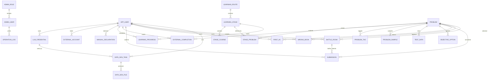

# 题阵 · 数据库设计

> 文档版本：v0.7（首期实现回写；整体设计评审定稿 + v0.9 手动申报审核 + v0.9.1 用户逻辑删除）
> 编写日期：2026-11-09；评审修订：2026-11-10；实现回写：2026-11-11
> 审核状态：已确认（2026-11-09）；2026-11-10 整体评审修订；2026-11-11 同步首期实现迁移
> 依据：`docs/PRD-v0.9.md`（v0.9.1 内容）、`docs/design/01.功能模块梳理.md`、`docs/design/02.整体架构设计.md`、`docs/rules/database-rules.md`
> 可执行迁移：`backend/tizhen-core/src/main/resources/db/migration/V1__init_schema.sql`、`V2__manual_declaration_review.sql`、`V3__app_user_soft_delete.sql`（由 Flyway 管理）；`scripts/sql/schema.sql` 为最新结构设计快照
> 范围：核心实体、表结构、字段、主键、约束、索引、逻辑关联、删除策略与关键统计口径。
> 不在本阶段范围：API 路径与请求响应、前端交互、业务代码、分库分表、物理外键。

---

## 1. 设计目标与范围

### 1.1 设计目标

1. 以第一阶段确认的 9 个功能模块为边界，表归属清晰，不新增 PRD 未定义的功能。
2. 用关系模型承载用户、内容、题库、提交、首次 AC、榜单来源、对战、造数据与审计数据。
3. 用唯一约束和状态字段兜底关键业务规则，应用层负责跨表关联校验。
4. 遵循 `database-rules.md`：`snake_case`、自增主键、禁止物理外键、必填字段 `NOT NULL`、UTC 存储、状态有限且可文档化。
5. 首期规模（注册 < 1 万、日活 < 1 千、同时判题 < 50）下，结构以简单、可维护、可查询为主，不做分库分表。

### 1.2 已确认的数据设计决策

| 编号 | 决策 | 结论 | 影响 |
|---|---|---|---|
| DB-DEC-01 | CF 周数据如何保存 | 只保存当前周快照 + 历史累计，不建按周历史表 | 周榜只读当前周；历史周不可追溯 |
| DB-DEC-02 | 对战记录是否独立建表 | `battle_room` 房间结束后直接作为记录，不另建记录表 | 双方提交通过 `submission.battle_id` 关联 |
| DB-DEC-03 | 造数据 std 语言 | 首期支持 C++17 与 Python 3.10+ | `data_gen_task.std_language` + 沙箱按语言执行 |
| DB-DEC-04 | 删除策略 | 软删除/状态停用为主；唯一约束只对有效记录生效；提交、首次 AC、对战、日志永久保留 | 使用 `deleted_at`、`removed_at`、`active_flag`、`status` |
| DB-DEC-05 | 首次 AC 的存储 | 独立 `first_ac` 事实表，`(user_id, problem_id)` 唯一 | 并发提交不会重复计数；榜单只消费该事实 |
| DB-DEC-06 | 提交表是否按题型拆分 | 统一 `submission` 表，按 `problem_type` 区分字段 | 普通提交与对战提交共用判题链路 |
| DB-DEC-07 | 榜单是否保存快照 | 不保存排名快照，全部派生查询 | 无榜单表、无排名缓存表 |
| DB-DEC-08 | 时间与自然周 | 时间 UTC 存储；业务周保存“周一日期”；周榜查询换算为 UTC 时间窗 | 避免时区边界歧义 |
| DB-DEC-09 | 结构化字段 | 数据范围、评分要点、客观题答案、权限、审计附加信息使用 JSON | 不把多个独立业务值拼成字符串 |
| DB-DEC-10 | 单人单进行中 LLM 任务 | `data_gen_task` 生成列 + 唯一约束兜底 | Redis 锁之外多一层数据库保证 |
| DB-DEC-11 | 简答题满分与及格线 | 满分固定 100，`score>=60` 为通过；简答题 `max_score` 只允许 100 | `problem` 增加检查约束；API 不再开放可变满分 |
| DB-DEC-12 | CF 多历史账号榜单口径 | 每个用户每个平台只取一条记录：当前有效绑定优先；无有效绑定时取最近解绑记录 | 周榜/总榜按该记录聚合；重新绑定后旧绑定不再计分 |

### 1.3 不在本阶段范围

- API 路径、请求响应、错误码与分页参数。
- 前端页面与交互。
- 业务代码、Mapper、SQL 查询实现。
- 数据初始化、演示种子数据、备份与恢复脚本。
- 分库分表、读写分离、物理外键、数据库触发器。

---

## 2. 设计规范与约定

### 2.1 命名与表风格

- 数据库、表、字段、索引、约束统一使用小写英文 + 下划线。
- 表名使用**单数**，例如 `app_user`、`problem`、`submission`。
- 主键统一命名为 `id`；逻辑关联字段使用 `<实体>_id`，例如 `user_id`、`problem_id`。
- 时间字段使用 `created_at`、`updated_at`、`deleted_at`、`completed_at` 等明确语义名称。
- 避免 MySQL 保留字；选手表使用 `app_user`，后台角色表使用 `admin_role`。

### 2.2 主键与关联

- 所有表使用 `BIGINT UNSIGNED AUTO_INCREMENT` 主键。
- **禁止物理外键**：不创建 `FOREIGN KEY`，不通过 ORM 生成外键；表间只保存逻辑关联 ID。
- 关联完整性由应用层维护：
  - 写入前校验被引用记录存在且状态允许。
  - 删除/停用前校验引用关系。
  - 唯一约束、检查约束作为数据库防线。
- 逻辑关联字段全部建立普通索引；高频查询按组合索引设计（见第 8 节）。

### 2.3 时间与自然周

- 所有 `DATETIME(3)` 均按 **UTC** 写入，展示层转换为 `Asia/Shanghai`。
- “北京时间自然周”定义为周一 00:00 至周日 24:00。
- 周相关字段保存**周一日期**，类型为 `DATE`：
  - `external_account.weekly_week_start`
  - `manual_declaration.week_start_date`
- 周榜查询站内首次 AC 时，将北京时间周一 00:00 换算为 UTC 时间窗：
  - 北京时间周一 00:00 = UTC 周日 16:00（Asia/Shanghai 固定 UTC+8）。
  - 查询区间使用左闭右开：`[week_start_utc, next_week_start_utc)`。
- 手动申报和 CF 周值直接按 `week_start_date` / `weekly_week_start` 精确匹配，不做时区换算。

### 2.4 字符集、排序规则与引擎

- 统一 `InnoDB`。
- 统一 `utf8mb4`，排序规则 `utf8mb4_0900_ai_ci`。
- 用户名、handle、邮箱等按大小写不敏感比较；登录时用户名大小写不敏感由该排序规则保证。
- 状态、类型、枚举使用 `VARCHAR` + `CHECK`，不使用 MySQL `ENUM`，避免枚举变更需要改表定义。
- 金额类数据本期没有；分数使用 `DECIMAL(5,2)`，避免浮点误差。

### 2.5 空值与默认值

- 业务必填字段 `NOT NULL`；仅“确实允许缺失”的字段可空。
- 不使用无业务含义的默认值掩盖缺失；例如 `deleted_at`、`completed_at`、`verdict` 默认 `NULL` 表示尚未发生。
- `status`、计数、布尔标记使用有明确语义的默认值。
- 布尔值统一 `TINYINT UNSIGNED`，取值 `0/1`。

### 2.6 软删除与“有效记录唯一”

首期采用以下组合：

| 机制 | 使用场景 | 唯一约束处理 |
|---|---|---|
| `status` 停用 | 用户、管理员、题目/内容上下架 | 不删除行 |
| `deleted_at` | 路线、阶段、课程、题目、手动申报 | 查询过滤 `deleted_at IS NULL` |
| `removed_at` | 错题本手动移除 | 保留行，再次出错恢复 |
| `active_flag` | 外部账号解绑、手动申报删除 | `1` = 有效，`NULL` = 失效；唯一键包含该列，实现“仅有效记录唯一” |
| `status = deleted` | LLM 凭证删除 | 保留行，清空密文，维持历史任务引用 |

MySQL 唯一索引允许多个 `NULL`，因此 `active_flag` 使用 `1` 或 `NULL`，而不是 `0/1`，才能让同一用户/平台/周在删除后可重新创建有效记录。

### 2.7 JSON 使用边界

以下字段使用 JSON，因为它们是结构化数组/对象，且首期不需要按内部字段做高频筛选：

- `problem.scoring_rubric`：简答题评分要点数组。
- `submission.answer_json`：客观题所选选项键数组。
- `admin_role.permissions`：权限编码数组；后端仍按角色编码鉴权。
- `data_gen_task.data_range`：变量定义数组。
- `data_gen_task.result_summary`：结果摘要对象。
- `operation_log.extra`：审计附加信息。

JSON 字段的完整结构由应用层 DTO 校验；数据库只保证 JSON 语法合法（JSON 类型本身保证），不替代业务校验。

---

## 3. 实体关系总览

### 3.1 模块与表归属

| 模块 | 表 | 说明 |
|---|---|---|
| M01 账号与权限 | `app_user`、`admin_user`、`admin_role`、`llm_credential` | 选手、管理员、角色、LLM 凭证 |
| M02 外部成绩接入 | `external_account`、`manual_declaration` | CF 账号与当前周/累计数据、其他平台周申报 |
| M03 学习内容与进度 | `learning_route`、`learning_stage`、`stage_course`、`stage_problem`、`learning_progress`、`external_completion` | 路线、阶段、课程、阶段题目、阶段完成、外链题完成 |
| M04 题库与判题 | `problem`、`problem_tag`、`problem_sample`、`test_data`、`objective_option`、`submission`、`first_ac`、`wrong_book` | 四类题目、标签、样例、测试数据、选项、提交、首次 AC、错题本 |
| M07 对战 | `battle_room` | 房间与对战记录 |
| M08 AI 造数据 | `data_gen_task`、`data_gen_file` | 造数据任务与结果文件元数据 |
| M09 后台支撑与审计 | `operation_log` | 后台操作日志 |

> M05 榜单、M06 学习记录不拥有独立事实表：榜单由 `first_ac`、`external_account`、`manual_declaration` 派生；学习记录读取 `learning_progress`、`submission`、`wrong_book`。这与“榜单是派生视图、不保存排名快照”的模块结论一致。

### 3.2 核心实体关系图

### 3.3 关系说明

- 一个选手可有多条提交、首次 AC、错题本记录、外部账号、申报、造数据任务；`llm_credential` 与选手是 1:1。
- 路线 1:N 阶段；阶段 1:N 课程；阶段 N:M 题目（`stage_problem`）。
- 题目 1:N 标签、样例、测试数据、选项、提交、首次 AC、错题本记录。
- 对战房间 N:1 题目、N:1 创建者、N:1 对手；双方提交通过 `submission.battle_id` 归属房间。
- 造数据任务 1:N 文件；任务 N:1 凭证（LLM 模式）；凭证删除后任务保留服务商/模型快照。
- 管理员 N:1 角色；管理员 1:N 操作日志。

---

## 4. 表结构设计

> 说明：以下表结构均与 `scripts/sql/schema.sql` 一致。完整 `CHECK` 约束、索引名与建表语句以脚本为准；本节列出字段、类型、空值、默认值与关键约束。

### 4.1 M01 账号与权限

#### 4.1.1 `admin_role` 后台角色

| 字段 | 类型 | 空 | 默认 | 说明 |
|---|---|---|---|---|
| `id` | BIGINT UNSIGNED | 否 | AUTO_INCREMENT | 主键 |
| `code` | VARCHAR(32) | 否 | — | 角色编码：`super_admin` / `content_operator` |
| `name` | VARCHAR(64) | 否 | — | 角色名称 |
| `permissions` | JSON | 否 | — | 权限编码数组；首期固定角色，后端按角色编码鉴权 |
| `created_at` | DATETIME(3) | 否 | CURRENT_TIMESTAMP(3) | 创建时间（UTC） |
| `updated_at` | DATETIME(3) | 否 | CURRENT_TIMESTAMP(3) | 更新时间（UTC） |

- 主键：`id`
- 唯一：`uk_admin_role_code(code)`
- 检查：`code IN ('super_admin','content_operator')`
- 初始化：脚本插入两个角色；不提供自定义角色。

#### 4.1.2 `admin_user` 管理员账号

| 字段 | 类型 | 空 | 默认 | 说明 |
|---|---|---|---|---|
| `id` | BIGINT UNSIGNED | 否 | AUTO_INCREMENT | 主键 |
| `username` | VARCHAR(32) | 否 | — | 登录用户名，全局唯一 |
| `password_hash` | VARCHAR(100) | 否 | — | BCrypt 哈希 |
| `display_name` | VARCHAR(64) | 否 | — | 后台显示名称 |
| `avatar_url` | VARCHAR(512) | 是 | NULL | 头像地址 |
| `role_id` | BIGINT UNSIGNED | 否 | — | 角色 ID，逻辑关联 `admin_role.id` |
| `status` | VARCHAR(16) | 否 | `active` | `active` / `disabled` |
| `last_login_at` | DATETIME(3) | 是 | NULL | 最近登录时间（UTC） |
| `created_at` | DATETIME(3) | 否 | CURRENT_TIMESTAMP(3) | 创建时间（UTC） |
| `updated_at` | DATETIME(3) | 否 | CURRENT_TIMESTAMP(3) | 更新时间（UTC） |

- 唯一：`uk_admin_user_username(username)`
- 索引：`role_id`、`status`
- 删除策略：不删除，只 `disabled`；禁用后删除会话。
- 说明：不开放注册，由超级管理员创建。

#### 4.1.3 `app_user` 选手账号

| 字段 | 类型 | 空 | 默认 | 说明 |
|---|---|---|---|---|
| `id` | BIGINT UNSIGNED | 否 | AUTO_INCREMENT | 主键 |
| `username` | VARCHAR(20) | 否 | — | 登录用户名，3–20 位字母/数字/下划线，大小写不敏感 |
| `password_hash` | VARCHAR(100) | 否 | — | BCrypt 哈希，禁止明文 |
| `nickname` | VARCHAR(64) | 否 | — | 站内展示昵称 |
| `email` | VARCHAR(254) | 是 | NULL | 绑定邮箱；首期只做基础绑定与展示 |
| `phone` | VARCHAR(32) | 是 | NULL | 可选手机号；仅本人与后台可见，不公开展示；不做验证/找回 |
| `avatar_url` | VARCHAR(512) | 是 | NULL | 头像地址 |
| `school` | VARCHAR(128) | 是 | NULL | 学校；可选 |
| `status` | VARCHAR(16) | 否 | `active` | `active` / `disabled` |
| `last_login_at` | DATETIME(3) | 是 | NULL | 最近登录时间（UTC） |
| `deleted_at` | DATETIME(3) | 是 | NULL | 逻辑删除时间（UTC）；非空表示后台已删除 |
| `created_at` | DATETIME(3) | 否 | CURRENT_TIMESTAMP(3) | 创建时间（UTC） |
| `updated_at` | DATETIME(3) | 否 | CURRENT_TIMESTAMP(3) | 更新时间（UTC） |

- 唯一：`uk_app_user_username(username)`、`uk_app_user_email(email)`（邮箱可空，多个 NULL 允许）
- 索引：`status`、`deleted_at`、`created_at`
- 检查：用户名长度 3–20；`status IN ('active','disabled')`
- 删除策略：后台删除采用逻辑删除，写 `deleted_at` 并同时置 `status='disabled'`；会话失效，历史数据保留。普通禁用只改 `status`，不写 `deleted_at`。
- 说明：邮箱首期不做验证码/找回密码/通知；手机号仅保留可选字段，仅本人与后台可见，榜单和公开页面不展示。

#### 4.1.4 `llm_credential` 选手 LLM 凭证

| 字段 | 类型 | 空 | 默认 | 说明 |
|---|---|---|---|---|
| `id` | BIGINT UNSIGNED | 否 | AUTO_INCREMENT | 主键 |
| `user_id` | BIGINT UNSIGNED | 否 | — | 选手 ID，逻辑关联 `app_user.id` |
| `provider` | VARCHAR(16) | 否 | — | `deepseek` / `qwen` / `zhipu` / `openai` |
| `model` | VARCHAR(64) | 是 | NULL | 可选模型名；为空用服务端默认模型 |
| `api_key_ciphertext` | MEDIUMTEXT | 是 | NULL | AES-256-GCM 密文（含 nonce/tag） |
| `api_key_last4` | CHAR(4) | 是 | NULL | Key 末 4 位，仅用于脱敏展示 |
| `encryption_key_version` | SMALLINT UNSIGNED | 否 | 1 | 加密密钥版本，便于轮换 |
| `status` | VARCHAR(16) | 否 | `valid` | `valid` / `invalid` / `deleted` |
| `last_validated_at` | DATETIME(3) | 是 | NULL | 最近校验时间（UTC） |
| `last_validation_error` | VARCHAR(512) | 是 | NULL | 最近校验失败原因，不得含 Key 明文 |
| `deleted_at` | DATETIME(3) | 是 | NULL | 软删除时间（UTC） |
| `created_at` | DATETIME(3) | 否 | CURRENT_TIMESTAMP(3) | 创建时间（UTC） |
| `updated_at` | DATETIME(3) | 否 | CURRENT_TIMESTAMP(3) | 更新时间（UTC） |

- 唯一：`uk_llm_credential_user(user_id)`，每人一行。
- 索引：`status`
- 检查：
  - `provider` 属于四家预置服务商。
  - `status='deleted'` 时密文必须为空；非删除状态必须有密文。
- 删除策略：软删除，清空密文与末四位；行保留以维持历史 `data_gen_task.llm_credential_id` 引用。
- 说明：任务进行中禁止替换/删除由应用层校验；后台只能查看配置状态、服务商与最近校验结果。

### 4.2 M02 外部成绩接入

#### 4.2.1 `external_account` 外部账号

| 字段 | 类型 | 空 | 默认 | 说明 |
|---|---|---|---|---|
| `id` | BIGINT UNSIGNED | 否 | AUTO_INCREMENT | 主键 |
| `user_id` | BIGINT UNSIGNED | 否 | — | 选手 ID |
| `platform` | VARCHAR(32) | 否 | — | 外部平台；首期固定 `codeforces` |
| `handle` | VARCHAR(64) | 否 | — | 平台账号 handle |
| `profile_url` | VARCHAR(512) | 是 | NULL | 平台个人主页 |
| `verification_status` | VARCHAR(16) | 否 | `simulated` | `verified` / `simulated` / `unverified` |
| `data_source` | VARCHAR(16) | 否 | `simulated` | `simulated` / `api` |
| `weekly_count` | INT UNSIGNED | 否 | 0 | 当前统计周过题数 |
| `weekly_week_start` | DATE | 是 | NULL | 当前统计周周一日期 |
| `all_time_count` | INT UNSIGNED | 否 | 0 | 历史累计过题数 |
| `last_sync_at` | DATETIME(3) | 是 | NULL | 最近同步时间（UTC） |
| `status` | VARCHAR(16) | 否 | `active` | `active` / `unbound` |
| `unbound_at` | DATETIME(3) | 是 | NULL | 解绑时间（UTC） |
| `active_flag` | TINYINT UNSIGNED | 是 | 1 | 有效标记：1=有效，NULL=已解绑；用于唯一约束 |
| `created_at` | DATETIME(3) | 否 | CURRENT_TIMESTAMP(3) | 创建时间（UTC） |
| `updated_at` | DATETIME(3) | 否 | CURRENT_TIMESTAMP(3) | 更新时间（UTC） |

- 唯一：
  - `uk_external_account_platform_handle_active(platform, handle, active_flag)`
  - `uk_external_account_user_platform_active(user_id, platform, active_flag)`
- 索引：`(user_id, created_at)`、`(weekly_week_start, user_id)`
- 检查：有效/解绑状态与 `active_flag`、`unbound_at` 一致；周起始日期必须是周一。
- 删除策略：解绑不删除，`status='unbound'`、`active_flag=NULL`；历史周值与累计值保留；handle 解绑后可被其他选手重新绑定。
- 说明：只保存当前周快照与历史累计，不保留按周历史；周榜按 `weekly_week_start` 匹配当前周。同一用户存在多条历史绑定时，榜单聚合按 7.2 的“单一记录”口径取数。

#### 4.2.2 `manual_declaration` 其他平台手动申报

| 字段 | 类型 | 空 | 默认 | 说明 |
|---|---|---|---|---|
| `id` | BIGINT UNSIGNED | 否 | AUTO_INCREMENT | 主键 |
| `user_id` | BIGINT UNSIGNED | 否 | — | 选手 ID |
| `platform` | VARCHAR(32) | 否 | — | 申报平台，例如 牛客 / 洛谷 / AtCoder |
| `account` | VARCHAR(128) | 否 | — | 平台账号或主页标识 |
| `profile_url` | VARCHAR(512) | 是 | NULL | 平台主页地址 |
| `count` | INT UNSIGNED | 否 | — | 本周申报过题数 |
| `week_start_date` | DATE | 否 | — | 申报自然周周一日期 |
| `verification_status` | VARCHAR(16) | 否 | `unverified` | `unverified` / `verified` / `rejected` |
| `review_note` | VARCHAR(200) | 是 | NULL | 审核备注，仅后台可见 |
| `reviewed_by` | BIGINT UNSIGNED | 是 | NULL | 审核管理员 ID；逻辑关联 `admin_user.id` |
| `reviewed_at` | DATETIME(3) | 是 | NULL | 最近审核时间（UTC） |
| `active_flag` | TINYINT UNSIGNED | 是 | 1 | 1=有效，NULL=已删除 |
| `deleted_at` | DATETIME(3) | 是 | NULL | 软删除时间（UTC） |
| `created_at` | DATETIME(3) | 否 | CURRENT_TIMESTAMP(3) | 创建时间（UTC） |
| `updated_at` | DATETIME(3) | 否 | CURRENT_TIMESTAMP(3) | 更新时间（UTC） |

- 唯一：`uk_manual_declaration_user_platform_week(user_id, platform, week_start_date, active_flag)`
- 索引：`(week_start_date, user_id)`、`(user_id, created_at)`、`(verification_status, active_flag, week_start_date, user_id)`
- 检查：周起始日期必须是周一；有效/删除标记与 `deleted_at` 一致；`verification_status IN ('unverified','verified','rejected')`。
- 删除策略：软删除，`active_flag=NULL`；删除后不再计入周榜/总榜；同一周可重新申报并生成新有效记录。
- 说明：同一用户+平台+自然周只保留一条有效记录，重复提交覆盖原值。

### 4.3 M03 学习内容与进度

#### 4.3.1 `learning_route` 学习路线

| 字段 | 类型 | 空 | 默认 | 说明 |
|---|---|---|---|---|
| `id` | BIGINT UNSIGNED | 否 | AUTO_INCREMENT | 主键 |
| `name` | VARCHAR(100) | 否 | — | 路线名称（专题） |
| `description` | TEXT | 是 | NULL | 路线简介 |
| `cover_url` | VARCHAR(512) | 是 | NULL | 封面地址 |
| `sort_order` | INT | 否 | 0 | 排序值，越小越靠前 |
| `status` | VARCHAR(16) | 否 | `draft` | `draft` / `published` / `offline` |
| `deleted_at` | DATETIME(3) | 是 | NULL | 软删除时间（UTC） |
| `created_at` | DATETIME(3) | 否 | CURRENT_TIMESTAMP(3) | 创建时间（UTC） |
| `updated_at` | DATETIME(3) | 否 | CURRENT_TIMESTAMP(3) | 更新时间（UTC） |

- 索引：`(status, sort_order)`
- 删除策略：软删除；存在阶段或学习进度时阻止删除，提示先下架/处理引用。

#### 4.3.2 `learning_stage` 学习阶段

| 字段 | 类型 | 空 | 默认 | 说明 |
|---|---|---|---|---|
| `id` | BIGINT UNSIGNED | 否 | AUTO_INCREMENT | 主键 |
| `route_id` | BIGINT UNSIGNED | 否 | — | 路线 ID，逻辑关联 `learning_route.id` |
| `name` | VARCHAR(100) | 否 | — | 阶段名称 |
| `content` | MEDIUMTEXT | 是 | NULL | 图文内容（富文本） |
| `sort_order` | INT | 否 | 0 | 路线内排序值 |
| `status` | VARCHAR(16) | 否 | `draft` | `draft` / `published` / `offline` |
| `deleted_at` | DATETIME(3) | 是 | NULL | 软删除时间（UTC） |
| `created_at` | DATETIME(3) | 否 | CURRENT_TIMESTAMP(3) | 创建时间（UTC） |
| `updated_at` | DATETIME(3) | 否 | CURRENT_TIMESTAMP(3) | 更新时间（UTC） |

- 索引：`(route_id, sort_order)`、`status`
- 删除策略：软删除；存在课程、阶段题目或学习进度时阻止删除。

#### 4.3.3 `stage_course` 阶段课程

| 字段 | 类型 | 空 | 默认 | 说明 |
|---|---|---|---|---|
| `id` | BIGINT UNSIGNED | 否 | AUTO_INCREMENT | 主键 |
| `stage_id` | BIGINT UNSIGNED | 否 | — | 阶段 ID，逻辑关联 `learning_stage.id` |
| `title` | VARCHAR(200) | 否 | — | 课程标题 |
| `url` | VARCHAR(512) | 否 | — | B 站视频完整链接 |
| `duration_seconds` | INT UNSIGNED | 是 | NULL | 视频时长（秒） |
| `source` | VARCHAR(128) | 是 | NULL | 来源/UP 主 |
| `sort_order` | INT | 否 | 0 | 阶段内排序值 |
| `status` | VARCHAR(16) | 否 | `published` | `draft` / `published` / `offline` |
| `deleted_at` | DATETIME(3) | 是 | NULL | 软删除时间（UTC） |
| `created_at` | DATETIME(3) | 否 | CURRENT_TIMESTAMP(3) | 创建时间（UTC） |
| `updated_at` | DATETIME(3) | 否 | CURRENT_TIMESTAMP(3) | 更新时间（UTC） |

- 索引：`(stage_id, sort_order)`、`status`
- 删除策略：软删除；课程无观看进度，删除不影响学习进度。
- 说明：保存时应用层规范化为 `https://www.bilibili.com/video/BV...`；不内嵌播放、不下载。

#### 4.3.4 `stage_problem` 阶段题目关联

| 字段 | 类型 | 空 | 默认 | 说明 |
|---|---|---|---|---|
| `id` | BIGINT UNSIGNED | 否 | AUTO_INCREMENT | 主键 |
| `stage_id` | BIGINT UNSIGNED | 否 | — | 阶段 ID |
| `problem_id` | BIGINT UNSIGNED | 否 | — | 题目 ID |
| `sort_order` | INT | 否 | 0 | 阶段内题目排序 |
| `created_at` | DATETIME(3) | 否 | CURRENT_TIMESTAMP(3) | 创建时间（UTC） |

- 唯一：`uk_stage_problem(stage_id, problem_id)`
- 索引：`problem_id`
- 删除策略：解除关联时物理删除；不保留关联历史。
- 说明：同一题可被多个阶段引用；题目生命周期归 M04。

#### 4.3.5 `learning_progress` 阶段完成状态

| 字段 | 类型 | 空 | 默认 | 说明 |
|---|---|---|---|---|
| `id` | BIGINT UNSIGNED | 否 | AUTO_INCREMENT | 主键 |
| `user_id` | BIGINT UNSIGNED | 否 | — | 选手 ID |
| `stage_id` | BIGINT UNSIGNED | 否 | — | 阶段 ID |
| `completed` | TINYINT UNSIGNED | 否 | 0 | 是否完成：0/1 |
| `completed_at` | DATETIME(3) | 是 | NULL | 完成时间（UTC） |
| `created_at` | DATETIME(3) | 否 | CURRENT_TIMESTAMP(3) | 创建时间（UTC） |
| `updated_at` | DATETIME(3) | 否 | CURRENT_TIMESTAMP(3) | 更新时间（UTC） |

- 唯一：`uk_learning_progress_user_stage(user_id, stage_id)`
- 索引：`(stage_id, completed)`
- 检查：`completed=0` 时 `completed_at` 为空；`completed=1` 时必须有完成时间。
- 删除策略：不删除；取消完成时 `completed=0`、`completed_at=NULL`。
- 说明：路线进度只按已完成阶段数 / 阶段总数计算；阶段总数为 0 时进度为 0。

#### 4.3.6 `external_completion` 外链题完成状态

| 字段 | 类型 | 空 | 默认 | 说明 |
|---|---|---|---|---|
| `id` | BIGINT UNSIGNED | 否 | AUTO_INCREMENT | 主键 |
| `user_id` | BIGINT UNSIGNED | 否 | — | 选手 ID |
| `problem_id` | BIGINT UNSIGNED | 否 | — | 外链题 ID |
| `completed` | TINYINT UNSIGNED | 否 | 0 | 是否完成：0/1 |
| `completion_source` | VARCHAR(16) | 否 | `manual` | `auto` / `manual` |
| `completed_at` | DATETIME(3) | 是 | NULL | 完成时间（UTC） |
| `created_at` | DATETIME(3) | 否 | CURRENT_TIMESTAMP(3) | 创建时间（UTC） |
| `updated_at` | DATETIME(3) | 否 | CURRENT_TIMESTAMP(3) | 更新时间（UTC） |

- 唯一：`uk_external_completion_user_problem(user_id, problem_id)`
- 索引：`problem_id`
- 检查：完成状态与完成时间一致；来源为 `auto`/`manual`。
- 删除策略：不删除；取消完成时置 `completed=0`。
- 说明：只用于学习进度展示，不计入榜单；本版仅手动标记，`auto` 枚举保留但无写入路径（无单题 CF AC 数据源）。

### 4.4 M04 题库与判题

#### 4.4.1 `problem` 题目主表

| 字段 | 类型 | 空 | 默认 | 说明 |
|---|---|---|---|---|
| `id` | BIGINT UNSIGNED | 否 | AUTO_INCREMENT | 主键 |
| `type` | VARCHAR(16) | 否 | — | `oj` / `objective` / `short_answer` / `external` |
| `objective_type` | VARCHAR(16) | 是 | NULL | `judge` / `single` / `multiple`；仅客观题 |
| `title` | VARCHAR(200) | 否 | — | 题目标题 |
| `statement` | MEDIUMTEXT | 否 | — | 题面（富文本/Markdown） |
| `input_format` | MEDIUMTEXT | 是 | NULL | 输入格式；OJ 使用 |
| `output_format` | MEDIUMTEXT | 是 | NULL | 输出格式；OJ 使用 |
| `explanation` | MEDIUMTEXT | 是 | NULL | 客观题解析；可选 |
| `reference_answer` | MEDIUMTEXT | 是 | NULL | 简答题参考答案 |
| `scoring_rubric` | JSON | 是 | NULL | 简答题评分要点数组 |
| `max_score` | SMALLINT UNSIGNED | 否 | 100 | 简答题满分；本期固定 100 |
| `difficulty` | VARCHAR(16) | 否 | — | `entry` / `basic` / `advanced` |
| `source` | VARCHAR(64) | 否 | — | 来源，例如 站内原创 / Codeforces |
| `external_url` | VARCHAR(512) | 是 | NULL | 外链题地址；仅 external |
| `platform` | VARCHAR(32) | 是 | NULL | 外链题平台；仅 external |
| `time_limit_ms` | INT UNSIGNED | 是 | NULL | OJ 时限（毫秒） |
| `memory_limit_mb` | INT UNSIGNED | 是 | NULL | OJ 内存限制（MB） |
| `status` | VARCHAR(16) | 否 | `draft` | `draft` / `published` / `offline` |
| `deleted_at` | DATETIME(3) | 是 | NULL | 软删除时间（UTC） |
| `created_at` | DATETIME(3) | 否 | CURRENT_TIMESTAMP(3) | 创建时间（UTC） |
| `updated_at` | DATETIME(3) | 否 | CURRENT_TIMESTAMP(3) | 更新时间（UTC） |

- 索引：`(type, status)`、`difficulty`、`source`、`created_at`
- 检查：
  - 题型、客观题类型、难度、状态取值合法。
  - 客观题必须有 `objective_type`；非客观题不得有。
  - 外链题必须有 `external_url` 与 `platform`。
  - 发布 OJ 题必须有时限和内存限制。
  - 简答题 `max_score` 必须为 100；发布时还必须有参考答案与评分要点。
  - 发布外链题必须有外链地址。
- 删除策略：
  - 被 `stage_problem`、`submission`、`first_ac`、`wrong_book`、`battle_room`、`external_completion` 引用时，不得软删除，也不得物理删除；只能 `status='offline'` 下架。
  - 无引用时可软删除；历史提交/首次 AC 仍保留。
- 说明：题目下架不回溯已产生的首次 AC；榜单查询不按 `problem.status` 过滤。

#### 4.4.2 `problem_tag` 题目标签

| 字段 | 类型 | 空 | 默认 | 说明 |
|---|---|---|---|---|
| `id` | BIGINT UNSIGNED | 否 | AUTO_INCREMENT | 主键 |
| `problem_id` | BIGINT UNSIGNED | 否 | — | 题目 ID |
| `tag_type` | VARCHAR(16) | 否 | `topic` | 首期固定 `topic` |
| `tag_value` | VARCHAR(64) | 否 | — | 标签值，例如 动态规划 / 图论 |
| `created_at` | DATETIME(3) | 否 | CURRENT_TIMESTAMP(3) | 创建时间（UTC） |

- 唯一：`uk_problem_tag(problem_id, tag_type, tag_value)`
- 索引：`(tag_type, tag_value)`
- 删除策略：编辑题目时物理替换；标签本身无历史价值。
- 说明：难度、来源、题型使用 `problem` 主表字段，不重复存入标签表。

#### 4.4.3 `problem_sample` 题面样例

| 字段 | 类型 | 空 | 默认 | 说明 |
|---|---|---|---|---|
| `id` | BIGINT UNSIGNED | 否 | AUTO_INCREMENT | 主键 |
| `problem_id` | BIGINT UNSIGNED | 否 | — | 题目 ID |
| `input_data` | MEDIUMTEXT | 是 | NULL | 样例输入 |
| `output_data` | MEDIUMTEXT | 是 | NULL | 样例输出 |
| `explanation` | TEXT | 是 | NULL | 样例说明 |
| `sort_order` | SMALLINT UNSIGNED | 否 | 0 | 样例顺序 |
| `created_at` | DATETIME(3) | 否 | CURRENT_TIMESTAMP(3) | 创建时间（UTC） |
| `updated_at` | DATETIME(3) | 否 | CURRENT_TIMESTAMP(3) | 更新时间（UTC） |

- 唯一：`uk_problem_sample_sort(problem_id, sort_order)`
- 删除策略：编辑时物理替换；与判题测试数据分开，不参与判题。
- 说明：支持多组样例；样例不要求唯一或非空，但发布 OJ 题时应用层应至少校验一组。

#### 4.4.4 `test_data` 判题测试数据

| 字段 | 类型 | 空 | 默认 | 说明 |
|---|---|---|---|---|
| `id` | BIGINT UNSIGNED | 否 | AUTO_INCREMENT | 主键 |
| `problem_id` | BIGINT UNSIGNED | 否 | — | 题目 ID |
| `input_data` | LONGTEXT | 否 | — | 测试输入 |
| `output_data` | LONGTEXT | 否 | — | 标准输出 |
| `sort_order` | SMALLINT UNSIGNED | 否 | 0 | 测试点顺序 |
| `created_at` | DATETIME(3) | 否 | CURRENT_TIMESTAMP(3) | 创建时间（UTC） |
| `updated_at` | DATETIME(3) | 否 | CURRENT_TIMESTAMP(3) | 更新时间（UTC） |

- 唯一：`uk_test_data_problem_sort(problem_id, sort_order)`
- 删除策略：编辑题目时物理替换；不保留历史版本。
- 说明：首期直接存数据库，适合演示规模；后续数据量大时可迁移到文件存储，表结构保留元数据。

#### 4.4.5 `objective_option` 客观题选项

| 字段 | 类型 | 空 | 默认 | 说明 |
|---|---|---|---|---|
| `id` | BIGINT UNSIGNED | 否 | AUTO_INCREMENT | 主键 |
| `problem_id` | BIGINT UNSIGNED | 否 | — | 题目 ID |
| `option_key` | CHAR(1) | 否 | — | 选项键，例如 A/B/C/D |
| `content` | TEXT | 否 | — | 选项内容 |
| `is_correct` | TINYINT UNSIGNED | 否 | 0 | 是否正确答案：0/1 |
| `sort_order` | SMALLINT UNSIGNED | 否 | 0 | 选项顺序 |
| `created_at` | DATETIME(3) | 否 | CURRENT_TIMESTAMP(3) | 创建时间（UTC） |
| `updated_at` | DATETIME(3) | 否 | CURRENT_TIMESTAMP(3) | 更新时间（UTC） |

- 唯一：`uk_objective_option_problem_key(problem_id, option_key)`
- 索引：`(problem_id, sort_order)`
- 删除策略：编辑时物理替换。
- 说明：判断题使用 A=正确、B=错误；单选题必须恰有一个正确选项；多选题至少一个正确选项，由应用层校验。

#### 4.4.6 `submission` 提交/作答记录

| 字段 | 类型 | 空 | 默认 | 说明 |
|---|---|---|---|---|
| `id` | BIGINT UNSIGNED | 否 | AUTO_INCREMENT | 主键 |
| `user_id` | BIGINT UNSIGNED | 否 | — | 提交人 ID |
| `problem_id` | BIGINT UNSIGNED | 否 | — | 题目 ID |
| `problem_type` | VARCHAR(16) | 否 | — | 提交时题型快照：`oj` / `objective` / `short_answer` |
| `battle_id` | BIGINT UNSIGNED | 是 | NULL | 对战房间 ID；普通刷题为空 |
| `language` | VARCHAR(16) | 是 | NULL | `cpp17` / `python310`；仅 OJ |
| `code` | LONGTEXT | 是 | NULL | OJ 提交代码 |
| `answer_json` | JSON | 是 | NULL | 客观题所选选项键数组，例如 `["A","C"]` |
| `answer_text` | MEDIUMTEXT | 是 | NULL | 简答题文本答案 |
| `status` | VARCHAR(16) | 否 | `pending` | `pending` / `judging` / `grading` / `finished` / `failed` |
| `verdict` | VARCHAR(16) | 是 | NULL | `AC` / `WA` / `TLE` / `MLE` / `RE` / `CE` / `SYSTEM_ERROR` |
| `score` | DECIMAL(5,2) | 是 | NULL | 客观题得分或简答题 AI 分数，0–100 |
| `ai_feedback` | MEDIUMTEXT | 是 | NULL | 简答题 AI 评语 |
| `failure_reason` | TEXT | 是 | NULL | 判题/判分失败原因 |
| `judge_detail` | TEXT | 是 | NULL | 判题详情或首个失败测试点说明 |
| `compile_output` | MEDIUMTEXT | 是 | NULL | 编译输出/错误信息 |
| `judge_time_ms` | INT UNSIGNED | 是 | NULL | 最大运行时间（毫秒） |
| `memory_kb` | INT UNSIGNED | 是 | NULL | 最大内存占用（KB） |
| `judge_attempts` | SMALLINT UNSIGNED | 否 | 0 | worker 领取次数；用于崩溃恢复，非业务重试 |
| `judge_started_at` | DATETIME(3) | 是 | NULL | 判题/判分开始时间（UTC） |
| `judged_at` | DATETIME(3) | 是 | NULL | 判题/判分完成时间（UTC） |
| `created_at` | DATETIME(3) | 否 | CURRENT_TIMESTAMP(3) | 提交时间（UTC） |
| `updated_at` | DATETIME(3) | 否 | CURRENT_TIMESTAMP(3) | 更新时间（UTC） |

- 索引：
  - `(user_id, problem_id, created_at)`：本人该题提交历史。
  - `(problem_id, created_at)`：题目提交列表。
  - `(status, created_at)`：worker 领取待判任务。
  - `battle_id`：对战双方提交。
  - `(user_id, created_at)`：学习记录页提交历史。
- 关键检查：
  - 题型、状态、语言、结果取值合法。
  - OJ 必须有语言与代码。
  - 客观题必须有 `answer_json`。
  - 简答题必须有 `answer_text`。
  - `finished` 必须有 `verdict`。
  - `failed` 必须有失败原因。
- 删除策略：永久保留；只允许 worker 更新判题状态/结果字段，不允许删除。
- 说明：
  - 客观题提交后立即判分，`status='finished'`，`verdict=AC/WA`，`score=100/0`。
  - 简答题满分固定 100；提交后 `status='grading'`，AI 完成后 `finished`，`score` 为 0–100，`verdict` 按 `score >= 60` 映射 AC/WA。
  - 简答题 AI 判分失败 `status='failed'`，不写错题本，不自动重试。
- **V-01 已确认**：简答题满分固定 100，及格线固定 60；简答题 `problem.max_score` 只允许 100，评分要点之和必须为 100。该口径同步到 API 的 `ADM-PRB-02/04/06`、`SUB-01` 与 worker 判分规则。

#### 4.4.7 `first_ac` 首次 AC 事实

| 字段 | 类型 | 空 | 默认 | 说明 |
|---|---|---|---|---|
| `id` | BIGINT UNSIGNED | 否 | AUTO_INCREMENT | 主键 |
| `user_id` | BIGINT UNSIGNED | 否 | — | 选手 ID |
| `problem_id` | BIGINT UNSIGNED | 否 | — | OJ 题目 ID |
| `submission_id` | BIGINT UNSIGNED | 否 | — | 产生首次 AC 的提交 ID |
| `first_ac_at` | DATETIME(3) | 否 | — | 首次 AC 发生时间（UTC） |
| `created_at` | DATETIME(3) | 否 | CURRENT_TIMESTAMP(3) | 记录创建时间（UTC） |

- 唯一：
  - `uk_first_ac_user_problem(user_id, problem_id)`：同一用户同一题只计一次。
  - `uk_first_ac_submission(submission_id)`：一次提交最多产生一条首次 AC。
- 索引：`(first_ac_at, user_id)`、`(user_id, first_ac_at)`
- 删除策略：永久保留；题目下架、用户禁用均不删除。
- 说明：普通提交与对战提交共用；只对 OJ 题产生，应用层校验题型与 `verdict='AC'`。

#### 4.4.8 `wrong_book` 错题本

| 字段 | 类型 | 空 | 默认 | 说明 |
|---|---|---|---|---|
| `id` | BIGINT UNSIGNED | 否 | AUTO_INCREMENT | 主键 |
| `user_id` | BIGINT UNSIGNED | 否 | — | 选手 ID |
| `problem_id` | BIGINT UNSIGNED | 否 | — | 题目 ID |
| `latest_error` | VARCHAR(64) | 否 | — | 最近错误标记，例如 `WA` / `TLE` / `AI 52` |
| `latest_score` | DECIMAL(5,2) | 是 | NULL | 简答题最近 AI 分数；其他题型为空 |
| `error_count` | INT UNSIGNED | 否 | 1 | 累计错误次数 |
| `last_error_at` | DATETIME(3) | 否 | — | 最近错误时间（UTC） |
| `removed_at` | DATETIME(3) | 是 | NULL | 手动移除时间；再次出错时置空 |
| `created_at` | DATETIME(3) | 否 | CURRENT_TIMESTAMP(3) | 创建时间（UTC） |
| `updated_at` | DATETIME(3) | 否 | CURRENT_TIMESTAMP(3) | 更新时间（UTC） |

- 唯一：`uk_wrong_book_user_problem(user_id, problem_id)`
- 索引：`(user_id, removed_at, last_error_at)`、`problem_id`
- 删除策略：不物理删除；选手移除时只写 `removed_at`。
- 说明：
  - 来源：OJ 非 AC（含对战非 AC）、客观题错误、简答题低于 60 分。
  - 再次出错时恢复为未移除，并累计 `error_count`；再次 AC/简答通过不自动移除。
  - AI 判分失败不进入错题本。

### 4.5 M07 对战

#### 4.5.1 `battle_room` 对战房间/记录

| 字段 | 类型 | 空 | 默认 | 说明 |
|---|---|---|---|---|
| `id` | BIGINT UNSIGNED | 否 | AUTO_INCREMENT | 主键 |
| `room_code` | VARCHAR(16) | 否 | — | 邀请码/房间码 |
| `creator_id` | BIGINT UNSIGNED | 否 | — | 创建者 ID |
| `opponent_id` | BIGINT UNSIGNED | 是 | NULL | 对手 ID |
| `problem_id` | BIGINT UNSIGNED | 是 | NULL | 抽取的题目 ID |
| `filter_difficulty` | VARCHAR(16) | 是 | NULL | 创建时难度筛选 |
| `filter_tag` | VARCHAR(64) | 是 | NULL | 创建时专题标签筛选 |
| `creator_ready` | TINYINT UNSIGNED | 否 | 0 | 创建者准备：0/1 |
| `opponent_ready` | TINYINT UNSIGNED | 否 | 0 | 对手准备：0/1 |
| `status` | VARCHAR(16) | 否 | `waiting` | `waiting` / `ready` / `ongoing` / `finished` / `cancelled` |
| `result` | VARCHAR(16) | 是 | NULL | 相对创建者：`creator_win` / `opponent_win` / `draw` |
| `end_reason` | VARCHAR(16) | 是 | NULL | `first_ac` / `timeout` / `surrender` / `disconnect` / `cancelled` |
| `started_at` | DATETIME(3) | 是 | NULL | 开始时间（UTC） |
| `ended_at` | DATETIME(3) | 是 | NULL | 结束时间（UTC） |
| `created_at` | DATETIME(3) | 否 | CURRENT_TIMESTAMP(3) | 创建时间（UTC） |
| `updated_at` | DATETIME(3) | 否 | CURRENT_TIMESTAMP(3) | 更新时间（UTC） |

- 唯一：`uk_battle_room_code(room_code)`
- 索引：`(creator_id, created_at)`、`(opponent_id, created_at)`、`(status, created_at)`、`problem_id`
- 检查：双方不同；`finished` 必须有结果、开始/结束时间；`ongoing/finished` 必须有题目与开始时间。
- 删除策略：永久保留；不另建对战记录表。
- 说明：
  - 结果相对创建者保存；查询“我的对战记录”时按当前用户是创建者/对手映射为胜/负/平。
  - 双方提交通过 `submission.battle_id` 关联；断线判负写 `end_reason='disconnect'`。

### 4.6 M08 AI 造数据

#### 4.6.1 `data_gen_task` 造数据任务

| 字段 | 类型 | 空 | 默认 | 说明 |
|---|---|---|---|---|
| `id` | BIGINT UNSIGNED | 否 | AUTO_INCREMENT | 主键 |
| `user_id` | BIGINT UNSIGNED | 否 | — | 创建者 ID |
| `title` | VARCHAR(200) | 否 | — | 题目名称/任务标题 |
| `statement` | MEDIUMTEXT | 否 | — | 题面 |
| `input_format` | MEDIUMTEXT | 否 | — | 输入格式 |
| `output_format` | MEDIUMTEXT | 否 | — | 输出格式 |
| `std_code` | LONGTEXT | 否 | — | 用户提供的 std 代码 |
| `std_language` | VARCHAR(16) | 否 | `cpp17` | `cpp17` / `python310` |
| `data_range` | JSON | 否 | — | 数据范围变量定义数组 |
| `group_count` | SMALLINT UNSIGNED | 否 | 10 | 生成组数 |
| `generation_mode` | VARCHAR(24) | 否 | — | `random` / `llm_generator` / `llm_direct_data` |
| `special_requirements` | TEXT | 是 | NULL | LLM 模式特殊构造要求 |
| `llm_provider` | VARCHAR(16) | 是 | NULL | 服务商快照 |
| `llm_model` | VARCHAR(64) | 是 | NULL | 实际使用的模型快照 |
| `llm_credential_id` | BIGINT UNSIGNED | 是 | NULL | 使用的凭证 ID |
| `generator_code` | LONGTEXT | 是 | NULL | LLM 构造模式生成的构造器代码；仅内部可见 |
| `generator_status` | VARCHAR(24) | 否 | `not_applicable` | 构造器状态 |
| `llm_data_status` | VARCHAR(24) | 否 | `not_applicable` | LLM 直接生成状态 |
| `status` | VARCHAR(24) | 否 | `pending` | 任务整体状态 |
| `failure_stage` | VARCHAR(24) | 是 | NULL | 失败阶段 |
| `failure_reason` | TEXT | 是 | NULL | 失败原因 |
| `result_summary` | JSON | 是 | NULL | 结果摘要 |
| `time_limit_ms` | INT UNSIGNED | 否 | — | std/程序时限（毫秒） |
| `memory_limit_mb` | INT UNSIGNED | 否 | — | std/程序内存限制（MB） |
| `attempts` | SMALLINT UNSIGNED | 否 | 0 | worker 领取次数；用于崩溃恢复，非业务重试 |
| `started_at` | DATETIME(3) | 是 | NULL | 开始执行时间（UTC） |
| `finished_at` | DATETIME(3) | 是 | NULL | 结束时间（UTC） |
| `heartbeat_at` | DATETIME(3) | 是 | NULL | worker 心跳时间（UTC） |
| `files_expire_at` | DATETIME(3) | 否 | — | 文件过期时间（UTC），创建后 7 天 |
| `files_cleaned_at` | DATETIME(3) | 是 | NULL | 文件清理时间（UTC） |
| `active_llm_user_id` | BIGINT UNSIGNED | 是 | 生成列 | 进行中的 LLM 任务用户 ID；仅用于唯一约束 |
| `created_at` | DATETIME(3) | 否 | CURRENT_TIMESTAMP(3) | 创建时间（UTC） |
| `updated_at` | DATETIME(3) | 否 | CURRENT_TIMESTAMP(3) | 更新时间（UTC） |

- 唯一：`uk_data_gen_task_active_llm(active_llm_user_id)`
- 索引：`(user_id, created_at)`、`(status, created_at)`、`(user_id, status, generation_mode)`、`files_expire_at`
- 检查：
  - 模式、状态、构造器状态、LLM 数据状态、失败阶段、std 语言、服务商取值合法。
  - 随机模式不得带 LLM 字段；两种 LLM 模式必须有服务商与凭证 ID。
  - LLM 直接生成模式不得有构造器代码。
  - `success` 的 LLM 构造模式必须有构造器代码与完成时间。
  - `failed` 必须有失败原因。
- 生成列逻辑：当 `generation_mode <> 'random'` 且 `status` 属于进行中状态时，`active_llm_user_id = user_id`，否则为 `NULL`；唯一约束保证同一选手最多 1 个进行中的 LLM 任务。
- 删除策略：任务记录永久保留；只清理文件，不删除任务。
- 说明：
  - `status` 流转：随机 `pending → generating → success/failed`；LLM 构造 `pending → llm_generating → generating → success/failed`；LLM 直接生成 `pending → llm_data_generating → generating → success/failed`。
  - `generator_status`、`llm_data_status` 保存更细的阶段状态，便于详情页展示。
  - 文件到期只写 `files_cleaned_at` 与文件元数据，不删除任务参数/状态/失败原因。

#### 4.6.2 `data_gen_file` 造数据结果文件

| 字段 | 类型 | 空 | 默认 | 说明 |
|---|---|---|---|---|
| `id` | BIGINT UNSIGNED | 否 | AUTO_INCREMENT | 主键 |
| `task_id` | BIGINT UNSIGNED | 否 | — | 任务 ID |
| `group_index` | SMALLINT UNSIGNED | 否 | — | 数据组序号，从 1 开始 |
| `input_path` | VARCHAR(512) | 是 | NULL | 输入文件相对路径 |
| `output_path` | VARCHAR(512) | 是 | NULL | 输出文件相对路径 |
| `input_size_bytes` | BIGINT UNSIGNED | 是 | NULL | 输入文件大小 |
| `output_size_bytes` | BIGINT UNSIGNED | 是 | NULL | 输出文件大小 |
| `std_time_ms` | INT UNSIGNED | 是 | NULL | std 运行时间（毫秒） |
| `validation_status` | VARCHAR(16) | 否 | `pending` | `pending` / `passed` / `failed` |
| `validation_message` | TEXT | 是 | NULL | 校验信息或失败原因 |
| `file_deleted_at` | DATETIME(3) | 是 | NULL | 文件清理时间；为空表示仍保留 |
| `created_at` | DATETIME(3) | 否 | CURRENT_TIMESTAMP(3) | 创建时间（UTC） |
| `updated_at` | DATETIME(3) | 否 | CURRENT_TIMESTAMP(3) | 更新时间（UTC） |

- 唯一：`uk_data_gen_file_task_group(task_id, group_index)`
- 索引：`(task_id, validation_status)`
- 检查：组序号 > 0；校验状态取值合法。
- 删除策略：元数据永久保留；文件清理时写 `file_deleted_at`，下载接口返回文件已过期。
- 说明：文件路径由 `FileStorage` 抽象管理，不返回静态直链。

### 4.7 M09 后台支撑与审计

#### 4.7.1 `operation_log` 操作日志

| 字段 | 类型 | 空 | 默认 | 说明 |
|---|---|---|---|---|
| `id` | BIGINT UNSIGNED | 否 | AUTO_INCREMENT | 主键 |
| `admin_id` | BIGINT UNSIGNED | 否 | — | 操作管理员 ID |
| `action` | VARCHAR(64) | 否 | — | 操作编码 |
| `target_type` | VARCHAR(32) | 否 | — | 目标类型 |
| `target_id` | BIGINT UNSIGNED | 是 | NULL | 目标 ID；登录等无具体目标时为空 |
| `detail` | TEXT | 是 | NULL | 人类可读操作详情 |
| `extra` | JSON | 是 | NULL | 结构化附加信息 |
| `ip_address` | VARCHAR(45) | 是 | NULL | 客户端 IP；兼容 IPv6 |
| `user_agent` | VARCHAR(512) | 是 | NULL | User-Agent |
| `request_id` | VARCHAR(64) | 是 | NULL | 请求追踪 ID |
| `created_at` | DATETIME(3) | 否 | CURRENT_TIMESTAMP(3) | 创建时间（UTC） |

- 索引：`(admin_id, created_at)`、`(target_type, target_id)`、`created_at`
- 删除策略：永久保留；不可更新、不可删除。
- 说明：后台写操作通过 AOP 注解与业务同事务写入；审计失败业务回滚。`action` 建议值：`login`、`create`、`update`、`delete`、`publish`、`offline`、`enable`、`disable`、`reset_password`、`refresh_cf`。

---

## 5. 状态与枚举字典

| 表.字段 | 取值 | 说明 |
|---|---|---|
| `admin_role.code` | `super_admin` / `content_operator` | 首期固定角色 |
| `admin_user.status` | `active` / `disabled` | 禁用后会话失效 |
| `app_user.status` | `active` / `disabled` | 禁用后移出榜单、会话失效 |
| `llm_credential.provider` | `deepseek` / `qwen` / `zhipu` / `openai` | 预置服务商 |
| `llm_credential.status` | `valid` / `invalid` / `deleted` | 删除时清空密文 |
| `external_account.verification_status` | `verified` / `simulated` / `unverified` | 首期真实 API 校验为 `verified`；`simulated` 仅保留兼容 |
| `external_account.data_source` | `simulated` / `api` | 首期真实同步为 `api` |
| `external_account.status` | `active` / `unbound` | 解绑保留历史 |
| `manual_declaration.verification_status` | `unverified` / `verified` / `rejected` | 未审核不计分；通过计分；拒绝不计分 |
| `learning_route.status` | `draft` / `published` / `offline` | 内容状态 |
| `learning_stage.status` | `draft` / `published` / `offline` | 内容状态 |
| `stage_course.status` | `draft` / `published` / `offline` | 内容状态 |
| `learning_progress.completed` | `0` / `1` | 0=未完成，1=已完成 |
| `external_completion.completion_source` | `auto` / `manual` | 自动（预留）/手动 |
| `problem.type` | `oj` / `objective` / `short_answer` / `external` | 四类题目 |
| `problem.objective_type` | `judge` / `single` / `multiple` | 判断/单选/多选 |
| `problem.difficulty` | `entry` / `basic` / `advanced` | 对应 入门/基础/进阶 |
| `problem.status` | `draft` / `published` / `offline` | 上下架用 `offline` |
| `problem_tag.tag_type` | `topic` | 首期仅专题标签 |
| `submission.problem_type` | `oj` / `objective` / `short_answer` | 提交时题型快照 |
| `submission.status` | `pending` / `judging` / `grading` / `finished` / `failed` | 判题/判分状态 |
| `submission.verdict` | `AC` / `WA` / `TLE` / `MLE` / `RE` / `CE` / `SYSTEM_ERROR` | OJ 结果；客观/简答用 AC/WA |
| `submission.language` | `cpp17` / `python310` | OJ 语言 |
| `battle_room.status` | `waiting` / `ready` / `ongoing` / `finished` / `cancelled` | 房间状态 |
| `battle_room.result` | `creator_win` / `opponent_win` / `draw` | 相对创建者 |
| `battle_room.end_reason` | `first_ac` / `timeout` / `surrender` / `disconnect` / `cancelled` | 结束原因 |
| `data_gen_task.generation_mode` | `random` / `llm_generator` / `llm_direct_data` | 三种造数据模式 |
| `data_gen_task.status` | `pending` / `llm_generating` / `llm_data_generating` / `generating` / `success` / `failed` | 任务整体状态 |
| `data_gen_task.generator_status` | `not_applicable` / `pending` / `generating` / `ready` / `failed` | 构造器阶段 |
| `data_gen_task.llm_data_status` | `not_applicable` / `pending` / `generating` / `validating` / `ready` / `failed` | 直接生成阶段 |
| `data_gen_task.failure_stage` | `llm_generator` / `llm_data` / `generator` / `validation` / `std` / `system` | 失败阶段 |
| `data_gen_task.std_language` | `cpp17` / `python310` | std 语言 |
| `data_gen_file.validation_status` | `pending` / `passed` / `failed` | 逐组校验状态 |
| `active_flag` | `1` / `NULL` | 1=有效，NULL=失效；用于有效记录唯一 |

---

## 6. 逻辑关联与删除策略

### 6.1 逻辑关联清单

| 父实体 | 子实体 | 关联字段 | 基数 | 应用层校验 |
|---|---|---|---|---|
| `admin_role` | `admin_user` | `admin_user.role_id` | 1:N | 角色必须存在且为预置角色 |
| `admin_user` | `operation_log` | `operation_log.admin_id` | 1:N | 管理员必须存在 |
| `app_user` | `llm_credential` | `llm_credential.user_id` | 1:1 | 每人一份；任务进行中禁止替换/删除 |
| `app_user` | `external_account` | `external_account.user_id` | 1:N | 同一平台最多一条有效绑定 |
| `app_user` | `manual_declaration` | `manual_declaration.user_id` | 1:N | 同用户+平台+周唯一 |
| `learning_route` | `learning_stage` | `learning_stage.route_id` | 1:N | 路线存在且未删除 |
| `learning_stage` | `stage_course` | `stage_course.stage_id` | 1:N | 阶段存在且未删除 |
| `learning_stage` | `stage_problem` | `stage_problem.stage_id` | 1:N | 阶段存在；题目存在且已发布 |
| `problem` | `stage_problem` | `stage_problem.problem_id` | 1:N | 题目存在；被引用时不可删除 |
| `problem` | `battle_room` | `battle_room.problem_id` | 1:N | 题目存在；抽题时固定，房间创建后不随题目下架变化 |
| `app_user` + `learning_stage` | `learning_progress` | `user_id` + `stage_id` | 1:1 | 用户/阶段存在 |
| `app_user` + `problem` | `external_completion` | `user_id` + `problem_id` | 1:1 | 仅外链题且已发布；用户存在 |
| `problem` | `problem_tag` | `problem_tag.problem_id` | 1:N | 题目存在 |
| `problem` | `problem_sample` | `problem_sample.problem_id` | 1:N | 题目存在 |
| `problem` | `test_data` | `test_data.problem_id` | 1:N | 题目存在；OJ 题 |
| `problem` | `objective_option` | `objective_option.problem_id` | 1:N | 题目存在；客观题 |
| `app_user` + `problem` | `submission` | `user_id` + `problem_id` | 1:N | 用户/题目存在；未禁用用户可提交 |
| `problem` | `first_ac` | `first_ac.problem_id` | 1:N | 仅 OJ；提交结果 AC |
| `app_user` + `problem` | `first_ac` | `user_id` + `problem_id` | 1:1 | 唯一约束兜底 |
| `app_user` + `problem` | `wrong_book` | `user_id` + `problem_id` | 1:1 | 错误事件触发；AI 失败不写 |
| `battle_room` | `submission` | `submission.battle_id` | 1:N | 房间存在；提交人属于房间 |
| `app_user` | `battle_room` | `creator_id` / `opponent_id` | 1:N | 双方不同；最多两人 |
| `app_user` | `data_gen_task` | `data_gen_task.user_id` | 1:N | 用户存在 |
| `llm_credential` | `data_gen_task` | `data_gen_task.llm_credential_id` | 1:N | 凭证归属该用户；LLM 模式必填 |
| `data_gen_task` | `data_gen_file` | `data_gen_file.task_id` | 1:N | 任务存在 |

### 6.2 删除/保留矩阵

| 表 | 删除方式 | 说明 |
|---|---|---|
| `app_user` | 后台删除采用逻辑删除：`deleted_at` + `status=disabled`；普通禁用只改状态 | 历史成绩、提交、榜单数据保留；榜单与登录过滤禁用/已删除用户 |
| `admin_user` | 不删除，`status=disabled` | 会话失效；操作日志保留 |
| `admin_role` | 不删除 | 首期固定两个角色 |
| `llm_credential` | 软删除，`status=deleted`，清空密文 | 行保留以维持任务引用 |
| `external_account` | 解绑，`status=unbound`，`active_flag=NULL` | 历史周值/累计值保留；handle 可被重新绑定 |
| `manual_declaration` | 软删除，`deleted_at` + `active_flag=NULL` | 删除后不计入周榜/总榜；可重新申报 |
| `learning_route` | 软删除 | 有阶段/进度引用时阻止 |
| `learning_stage` | 软删除 | 有课程/题目/进度引用时阻止 |
| `stage_course` | 软删除 | 无引用，直接软删除 |
| `stage_problem` | 物理删除 | 解除关联，不保留历史 |
| `learning_progress` | 不删除，`completed=0` | 取消完成 |
| `external_completion` | 不删除，`completed=0` | 取消完成 |
| `problem` | 被引用：只 `status=offline`；无引用：软删除 | 被阶段、提交、首次 AC、错题本、对战或外链题完成记录引用时不得删除 |
| `problem_tag` | 物理删除/替换 | 编辑题目时重建 |
| `problem_sample` | 物理删除/替换 | 编辑题目时重建 |
| `test_data` | 物理删除/替换 | 编辑题目时重建 |
| `objective_option` | 物理删除/替换 | 编辑题目时重建 |
| `submission` | 永久保留 | 只更新判题状态/结果 |
| `first_ac` | 永久保留 | 题目下架/用户禁用不删除 |
| `wrong_book` | 软移除 `removed_at` | 再次出错恢复；不物理删除 |
| `battle_room` | 永久保留 | 房间即记录 |
| `data_gen_task` | 永久保留 | 只清理文件 |
| `data_gen_file` | 元数据保留，文件清理 | 写 `file_deleted_at` |
| `operation_log` | 永久保留，不可更新/删除 | 审计不可篡改 |

### 6.3 被引用内容的删除边界

1. **题目**：被阶段、提交、首次 AC、错题本、对战或外链题完成记录引用时，后台“删除”只能转为下架；不物理删除，不软删除。下架后历史首次 AC 仍计入榜单。
2. **路线/阶段**：存在子阶段、课程、阶段题目或学习进度时，删除请求应被拒绝；需先解除引用或下架。
3. **课程**：无观看进度，可直接软删除；删除后 C 端立即不展示。
4. **用户/管理员**：选手账号支持后台逻辑删除（`deleted_at` + `disabled`），管理员账号只禁用；两者会话均失效，历史数据保留。
5. **外部账号**：解绑不删除；历史数据保留但不再更新；解绑后 handle 可被其他选手绑定。
6. **手动申报**：删除后该周记录不再计入总榜；如需保留审计，可改为作废标记但继续计分，需另行确认。

---

## 7. 关键业务口径与数据库落点

### 7.1 首次 AC

- **唯一事实表**：`first_ac`。
- **幂等写入**：`INSERT ... ON DUPLICATE KEY UPDATE` 或捕获唯一键冲突；`uk_first_ac_user_problem` 保证同一用户同一题只产生一条。
- **判定条件**：提交题型为 OJ、`verdict='AC'`；普通提交与对战提交共用。
- **时间**：`first_ac_at` 取判题完成时间（UTC），用于周榜区间过滤。
- **题目下架**：不清除 `first_ac`，榜单查询不按 `problem.status` 过滤。
- **用户禁用**：不清除 `first_ac`，榜单查询过滤 `app_user.status='active'`。

### 7.2 周榜与总榜

**周榜**（北京时间自然周）：

1. 计算本周周一日期 `week_start_date` 与下一周周一日期。
2. 站内过题：统计 `first_ac` 中 `first_ac_at` 落在 `[week_start_utc, next_week_start_utc)` 的记录数，按 `user_id` 聚合。
3. CF 过题：按本节“CF 账号选取口径”为每个用户选定唯一记录；仅当该记录 `weekly_week_start = week_start_date` 时取 `weekly_count`，否则按 0。
4. 手动申报：`SUM(manual_declaration.count)`，条件 `week_start_date = 本周`、`active_flag=1` 且 `verification_status='verified'`。
5. 过滤 `app_user.status='active'`。
6. 总分 = 站内 + CF + 手动；排序：总分降序、站内过题降序、并列。

**总榜**：

1. 站内过题：统计 `first_ac` 全部历史记录数，按 `user_id` 聚合。
2. CF 过题：按本节“CF 账号选取口径”为每个用户选定唯一记录，取该记录的 `all_time_count`。
3. 手动申报：`SUM(manual_declaration.count)`，条件 `active_flag=1` 且 `verification_status='verified'`，全部周累计。
4. 过滤 `app_user.status='active'`。
5. 总分 = 站内累计 + CF 累计 + 手动累计；排序规则同周榜。

**并列名次**：总分相同按站内过题降序；仍相同视为并列。名次编号已确认采用 `RANK()`（1,2,2,4），并保留并列展示。

**CF 账号选取口径（V-02 已确认 A）**：

1. 每个用户在每个平台只取一条 `external_account` 参与榜单，禁止把多条历史绑定相加。
2. 优先取 `active_flag=1` 的当前有效绑定。
3. 若没有有效绑定，取最近解绑的一条历史记录，排序为 `unbound_at DESC, id DESC`。
4. 选定记录后，周榜只在 `weekly_week_start = week_start_date` 时计 `weekly_count`，否则计 0；总榜取该记录 `all_time_count`。
5. 解绑后未重新绑定，保留最近一条历史绑定的累计成绩；重新绑定后旧绑定不再计分。

实现时可用窗口函数按 `user_id, platform` 分区，排序 `active_flag DESC, unbound_at DESC, id DESC` 取第一条，避免重复累计。

**数据来源标注**：站内来自 `first_ac`；CF 来自选定 `external_account` 记录的 `verification_status/data_source/last_sync_at`；手动申报来自审核通过（`verification_status='verified'`）记录的 `updated_at`，有计分申报时榜单状态返回 `verified`。

### 7.3 错题本

- **写入条件**：
  - OJ 非 AC（含 `battle_id` 非空）。
  - 客观题 `verdict='WA'`。
  - 简答题 `score < 60` 且判分成功。
  - AI 判分失败（`status='failed'`）不写错题本。
- **聚合**：`uk_wrong_book_user_problem` 唯一；Upsert 更新 `latest_error`、`latest_score`、`last_error_at`、`error_count = error_count + 1`。
- **手动移除**：写 `removed_at`；列表查询过滤 `removed_at IS NULL`。
- **再次出错**：`removed_at=NULL`，累计 `error_count`；不新建行。
- **再次 AC/通过**：不自动移除，符合 PRD。

### 7.4 对战

- `battle_room` 保存房间与结果；双方提交通过 `submission.battle_id` 关联。
- 先 AC：条件更新 `battle_room`，仅当 `status='ongoing'` 时写入 `result`、`end_reason='first_ac'`、`status='finished'`。
- 超时：`result='draw'`、`end_reason='timeout'`。
- 主动退出/断线：`end_reason='surrender'/'disconnect'`，按退出方与创建者关系写 `creator_win`/`opponent_win`。
- 结果相对创建者保存；前端按当前用户角色映射为胜/负/平。
- 断线阈值（心跳 5s、连续 2 次超时）由应用层与 Redis 心跳实现，不落库；只在结束时写 `end_reason`。

### 7.5 AI 造数据

- **并发**：`uk_data_gen_task_active_llm(active_llm_user_id)` 保证同一选手最多 1 个进行中的 LLM 任务；Redis 锁作为前置快速失败。
- **状态机**：见第 5 节；`generator_status` / `llm_data_status` 保存细分阶段。
- **文件**：`data_gen_file` 保存元数据；`files_expire_at` 创建后 7 天；清理任务写 `files_cleaned_at`、`file_deleted_at`，不删除任务。
- **凭证**：`llm_credential` 软删除保留行；`data_gen_task.llm_provider`/`llm_model` 保存快照，凭证删除后历史任务仍可解释“用了哪家、哪个模型”。
- **std 语言**：`std_language` 支持 `cpp17` / `python310`；沙箱按语言编译或解释执行。

### 7.6 审计

- `operation_log` 与后台写操作同事务写入；审计失败业务回滚。
- 只追加，不更新、不删除。
- `action`、`target_type` 使用应用层约定编码；`extra` 保存结构化变更信息，避免把敏感信息（密码、API Key、完整会话令牌）写入日志。

---

## 8. 索引设计

| 索引 | 表 | 字段 | 用途 |
|---|---|---|---|
| `uk_app_user_username` | `app_user` | `username` | 登录、唯一性 |
| `uk_app_user_email` | `app_user` | `email` | 邮箱唯一 |
| `uk_admin_user_username` | `admin_user` | `username` | 后台登录 |
| `uk_llm_credential_user` | `llm_credential` | `user_id` | 每人一份 |
| `uk_external_account_platform_handle_active` | `external_account` | `platform, handle, active_flag` | 一个平台账号只绑定一个有效用户 |
| `uk_external_account_user_platform_active` | `external_account` | `user_id, platform, active_flag` | 一个用户同一平台一个有效绑定 |
| `idx_external_account_week` | `external_account` | `weekly_week_start, user_id` | CF 周榜聚合 |
| `uk_manual_declaration_user_platform_week` | `manual_declaration` | `user_id, platform, week_start_date, active_flag` | 同周唯一 |
| `idx_manual_declaration_week` | `manual_declaration` | `week_start_date, user_id` | 周榜/总榜聚合 |
| `idx_manual_declaration_review` | `manual_declaration` | `verification_status, active_flag, week_start_date, user_id` | 仅审核通过记录计分 |
| `idx_learning_stage_route_sort` | `learning_stage` | `route_id, sort_order` | 路线详情 |
| `idx_stage_course_stage_sort` | `stage_course` | `stage_id, sort_order` | 阶段课程列表 |
| `uk_stage_problem` | `stage_problem` | `stage_id, problem_id` | 阶段题目唯一 |
| `uk_learning_progress_user_stage` | `learning_progress` | `user_id, stage_id` | 进度唯一 |
| `uk_external_completion_user_problem` | `external_completion` | `user_id, problem_id` | 外链题完成唯一 |
| `idx_problem_type_status` | `problem` | `type, status` | 题库筛选 |
| `idx_problem_difficulty` | `problem` | `difficulty` | 难度筛选 |
| `idx_problem_tag_value` | `problem_tag` | `tag_type, tag_value` | 专题筛选 |
| `idx_submission_status_created` | `submission` | `status, created_at` | worker 领取待判任务 |
| `idx_submission_user_problem_created` | `submission` | `user_id, problem_id, created_at` | 本人提交历史 |
| `idx_submission_battle` | `submission` | `battle_id` | 对战提交 |
| `uk_first_ac_user_problem` | `first_ac` | `user_id, problem_id` | 首次 AC 幂等 |
| `idx_first_ac_time_user` | `first_ac` | `first_ac_at, user_id` | 周榜站内聚合 |
| `uk_wrong_book_user_problem` | `wrong_book` | `user_id, problem_id` | 错题聚合 |
| `idx_wrong_book_user_active` | `wrong_book` | `user_id, removed_at, last_error_at` | 错题本列表 |
| `uk_battle_room_code` | `battle_room` | `room_code` | 邀请码查找 |
| `idx_battle_room_status` | `battle_room` | `status, created_at` | 对战大厅/清理 |
| `uk_data_gen_task_active_llm` | `data_gen_task` | `active_llm_user_id` | 单人单进行中 LLM 任务 |
| `idx_data_gen_task_status_created` | `data_gen_task` | `status, created_at` | worker 领取任务 |
| `idx_data_gen_task_expire` | `data_gen_task` | `files_expire_at` | 文件清理 |
| `uk_data_gen_file_task_group` | `data_gen_file` | `task_id, group_index` | 文件组唯一 |
| `idx_operation_log_admin_created` | `operation_log` | `admin_id, created_at` | 日志按管理员查询 |
| `idx_operation_log_target` | `operation_log` | `target_type, target_id` | 目标审计追踪 |

索引原则：

- 唯一约束优先承担业务唯一性，不重复建立同字段普通索引。
- 榜单查询按“时间 + 用户”组合索引；避免在 `first_ac_at` 上做函数计算，保持索引可用。
- 后台列表按状态 + 创建时间分页；避免全表扫描。
- 低选择性字段（如 `status` 单独）只在确实需要时建索引；组合索引通常更有效。

---

## 9. 数据完整性与约束检查

### 9.1 数据库约束

- 所有表有主键；主键自增、非空、唯一。
- 业务唯一值使用唯一约束：
  - 用户名、管理员用户名、角色编码、邮箱。
  - 每人一份 LLM 凭证。
  - 外部账号有效绑定、手动申报周记录。
  - 阶段题目、学习进度、外链题完成、错题本、首次 AC。
  - 对战房间码、造数据文件组。
  - 进行中的 LLM 任务（生成列唯一）。
- 状态/枚举使用 `CHECK` 限定有限集合。
- 关键条件使用 `CHECK`：
  - 完成状态与完成时间一致。
  - 首次 AC 的提交结果；由应用层保证，数据库通过 `submission` 的 `verdict` 检查辅助。
  - 对战结束状态必须有关闭时间、结果、题目。
  - 造数据成功/失败状态必须有完成时间/失败原因。
- 时间、分数、计数使用合适类型；分数 `DECIMAL(5,2)`；计数无符号。

### 9.2 应用层必须校验

数据库约束不能表达跨表/条件规则，以下由应用层保证：

1. `first_ac` 只对 OJ 题、`verdict='AC'` 的提交写入；写入时校验题目类型与提交归属。
2. `submission.problem_type` 必须与 `problem.type` 一致；客观题 `answer_json` 只能选该题选项；简答题 `answer_text` 非空。
3. 客观题：判断题恰有一个正确选项；单选题恰有一个；多选题至少一个；选项键属于该题。
4. 简答题满分固定 100，评分要点之和必须为 100；发布前还必须配置参考答案与评分要点。
5. OJ 题发布前必须有测试数据、时限、内存限制；测试点顺序连续。
6. 外链题必须有合法 URL 与平台；外链题完成只由该题型写入。
7. 课程 URL 必须规范化为 B 站视频链接；非法链接阻止保存。
8. `battle_room` 双方不同、最多两人；抽取题目符合难度/专题筛选且为 OJ 题。
9. `data_gen_task` 的 LLM 模式必须使用当前用户的有效凭证；凭证任务中不可替换/删除；任务状态机按第 7.5 节流转。
10. `manual_declaration` 同一用户+平台+周覆盖原有效记录，覆盖后审核状态重置为 `unverified`；`count` 非负；平台/账号长度校验；审核仅超管可执行，备注 ≤ 200 字符。
11. `operation_log` 与业务写操作同事务；不得记录密码、API Key、完整会话令牌。
12. 禁用用户：删除会话、拒绝登录、榜单过滤；历史数据保留。
13. 题目下架不删除 `first_ac`；榜单查询不按题目状态过滤。
14. 文件下载校验任务归属或管理员身份；文件过期返回明确错误。

### 9.3 为什么禁止物理外键

- 遵循 `database-rules.md` 的明确要求。
- 首期需要软删除、批量导入、演示数据重置和后续可能的模块拆分；物理外键会增加迁移与删除顺序约束。
- 代价是应用层必须严格校验关联；本项目通过唯一约束、状态机、事务和集成测试兜底。

---

## 10. 确认结果（已全部确认）

以下 7 项已于 2026-11-09 全部确认，均采用推荐方案；表内保留确认结论与影响说明。

| 编号 | 问题 | 确认结论 | 影响 |
|---|---|---|---|
| Q-DB-01 | 邮箱是否全局唯一 | **已确认：全局唯一**；`app_user.email` 唯一且可空 | 账号绑定、找回密码预留 |
| Q-DB-02 | 错题本移除后再次出错，错误次数是否累计 | **已确认：累计历史次数**；保留原行，恢复未移除状态，`error_count` 继续 +1 | 错题本错误次数展示与排序 |
| Q-DB-03 | 榜单并列名次编号 | **已确认：`RANK()`（1,2,2,4）**；总分相同按站内过题降序，仍相同并列 | 榜单排名展示 |
| Q-DB-04 | 操作日志保留周期 | **已确认：永久保留**、不自动清理 | 存储增长与审计追溯 |
| Q-DB-05 | 用户手机号是否保留/展示 | **已确认：保留可选字段**；仅本人与后台可见，不公开展示；不做验证/找回 | 个人资料字段与隐私边界 |
| Q-DB-06 | 手动申报删除后是否保留审计但继续计分 | **已确认：删除即不计入周榜/总榜**；软删除、保留审计行 | 总榜口径与审计 |
| Q-DB-07 | 题目/路线/阶段删除边界 | **已确认：有引用则阻止删除**；题目有历史提交/首次 AC 时只允许下架 | 后台删除交互与历史数据完整性 |

> 以上结论不改变首期主表结构；`schema.sql` 无需因本轮确认而调整。手机号仅本人和后台可见，榜单与公开页面不展示。

---

## 11. 设计检查结论

### 11.1 与业务需求的对应

| 需求 | 数据库落点 | 结论 |
|---|---|---|
| 用户注册/登录/禁用 | `app_user`、`admin_user`、会话由 Redis | 覆盖 |
| 邮箱基础绑定 | `app_user.email` | 覆盖；已确认全局唯一 |
| CF 绑定/解绑/同步 | `external_account` | 覆盖；解绑保留历史 |
| 其他平台周申报 | `manual_declaration` | 覆盖；同周唯一 |
| 路线/阶段/课程 | `learning_route`、`learning_stage`、`stage_course` | 覆盖 |
| 阶段题目复用 | `stage_problem` | 覆盖 |
| 阶段完成/外链题完成 | `learning_progress`、`external_completion` | 覆盖 |
| 四类题库 | `problem` + `problem_tag`/`problem_sample`/`test_data`/`objective_option` | 覆盖 |
| OJ 提交与判题 | `submission` + worker 状态 | 覆盖 |
| 客观题自动判分 | `submission.answer_json`/`verdict`/`score` | 覆盖 |
| 简答题 AI 判分 | `submission.answer_text`/`score`/`ai_feedback`/`status` | 覆盖 |
| 首次 AC | `first_ac` 唯一事实 | 覆盖 |
| 错题本 | `wrong_book` 聚合 | 覆盖 |
| 周榜/总榜 | 派生查询；无榜单表 | 覆盖 |
| 1v1 对战 | `battle_room` + `submission.battle_id` | 覆盖 |
| AI 造数据 | `data_gen_task`、`data_gen_file`、`llm_credential` | 覆盖 |
| 后台审计 | `operation_log` | 覆盖 |
| 管理员账号管理 | `admin_user`、`admin_role` | 覆盖 |

### 11.2 规范符合性

- 表名、字段名 `snake_case`，单数表名。
- 所有表自增主键；无物理外键。
- 必填字段 `NOT NULL`；时间 UTC；状态有限并记录在文档。
- 唯一约束覆盖业务唯一值；索引覆盖高频查询。
- 未引入 PRD 未定义的业务功能；外链题完成、对战记录、用户凭证均按已确认需求建模。

### 11.3 已知限制

1. 首期不保存 CF 按周历史，只保留当前周 + 历史累计；历史周榜不可追溯。
2. 榜单不保存快照，排名实时派生；数据量大时需缓存或预聚合，属于后续优化。
3. 测试数据存 `LONGTEXT`，适合演示规模；大数据量需迁移文件存储。
4. 操作日志永久保留，磁盘增长需运维监控。
5. 题目/路线等软删除与引用阻止由应用层实现，数据库不提供物理外键保护。

---

## 12. 脚本与验证记录

- 建表/变更脚本：`backend/tizhen-core/src/main/resources/db/migration/V1__init_schema.sql`、`V2__manual_declaration_review.sql`、`V3__app_user_soft_delete.sql`（Flyway 唯一执行来源）；`scripts/sql/schema.sql` 为最新结构设计快照，后续结构变更只新增迁移，不修改既有迁移。
- 目标环境：MySQL 8.4 LTS；脚本只使用 MySQL 8.0 已支持的语法与特性（`CHECK`、生成列、JSON、`utf8mb4_0900_ai_ci`）。
- 本地验证：在临时 MySQL 8.0.34 实例上从空库执行脚本，成功创建 **24 张表**，并插入两个基础角色。
- 代表性数据验证：在事务中向 24 张表插入覆盖各模块的样例数据，全部通过约束检查；随后回滚/清理。
- 关键约束验证：同一选手插入第二个“进行中 LLM 任务”时，被 `uk_data_gen_task_active_llm` 拒绝（`ERROR 1062`）；已完成的 LLM 任务不占用该唯一约束。
- 未在 MySQL 8.4 LTS 实机验证：本机仅有 8.0.34 临时实例；两者在本脚本使用的语法范围内兼容，部署前建议在目标 8.4 实例再执行一次。
- 2026-11-11 实现回写：新增 `V3__app_user_soft_delete.sql`，为 `app_user` 增加 `deleted_at` 与 `idx_app_user_deleted_at`；表数量仍为 24 张，`scripts/sql/schema.sql` 已同步该字段与索引。

---

*文档结束。*
